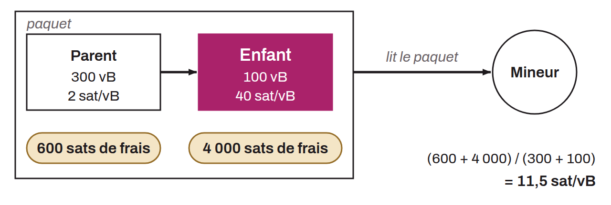

Transaction mechanism that speeds up the confirmation of a Bitcoin transaction, like Replace-by-Fee (RBF), but from the side of the recipient, or of the sender if it has a change output. When a transaction with fees too low compared with the market stays stuck in the mempools of nodes and does not confirm quickly enough, the recipient can create a new transaction that spends the bitcoin received in the stuck transaction, even though it is not yet confirmed (the sender can do the same with its change output). This second transaction can only be confirmed if the first one is mined, so miners have to include both transactions together. The second transaction pays much higher fees than the first, so that the average fee rate gives miners an incentive to include both. The child transaction (the second) pays for the stuck parent transaction (the first). This is why the mechanism is called CPFP (Child Pays For Parent).

CPFP thus lets the recipient receive their funds faster despite the low initial fees committed by the sender, unlike RBF (Replace-by-Fee), which lets the sender take the initiative to speed up their own transaction by increasing the fees.
