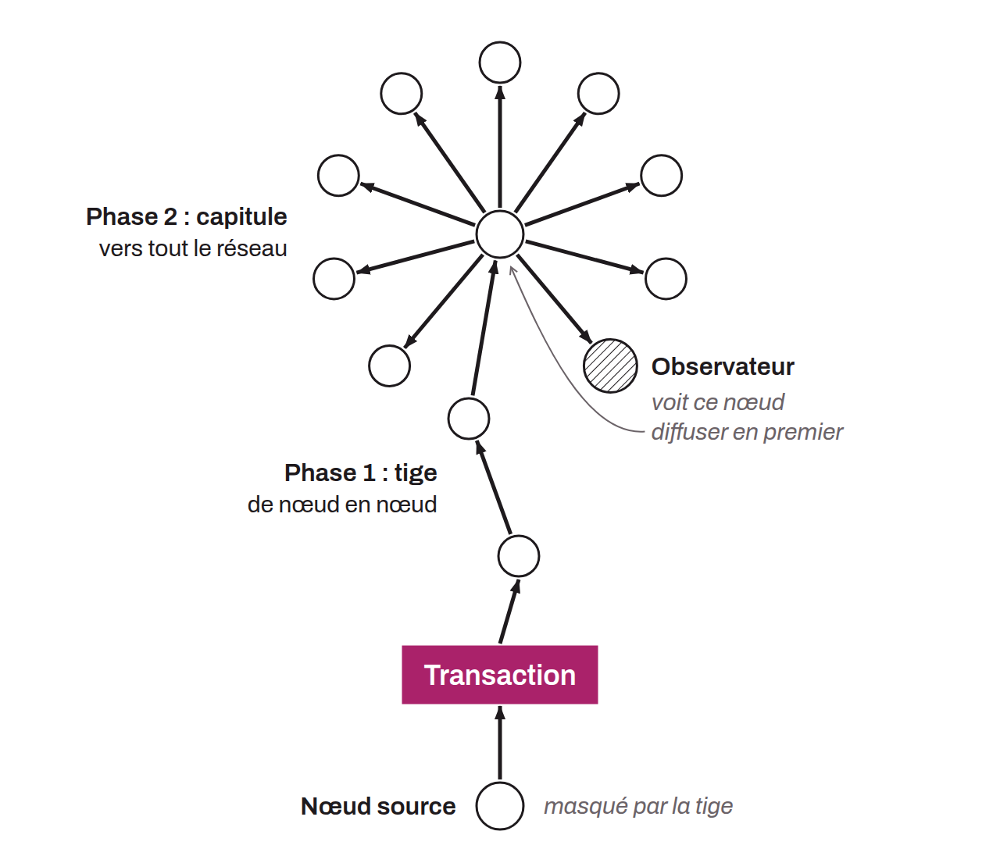

Proposal that aims to improve the privacy of transaction routing in the Bitcoin network to counter deanonymization. In the standard behavior of Bitcoin, each node sends transactions to its peers with independent exponential delays (the propagation). This can potentially allow observers to link transactions, normally anonymous, with IP addresses. The goal of BIP-0156 is to address this problem. To do so, it introduces an additional phase in the propagation that preserves anonymity before public propagation. Dandelion thus first uses a “stem” phase, in which the transaction is sent along a random path of nodes, before it is propagated to the entire network in the “fluff” phase. The stem and the fluff refer to the way a transaction spreads through the network, which resembles the shape of a dandelion. This routing method blurs the trail leading to the source node, making it difficult to trace a transaction through the network back to its origin.

