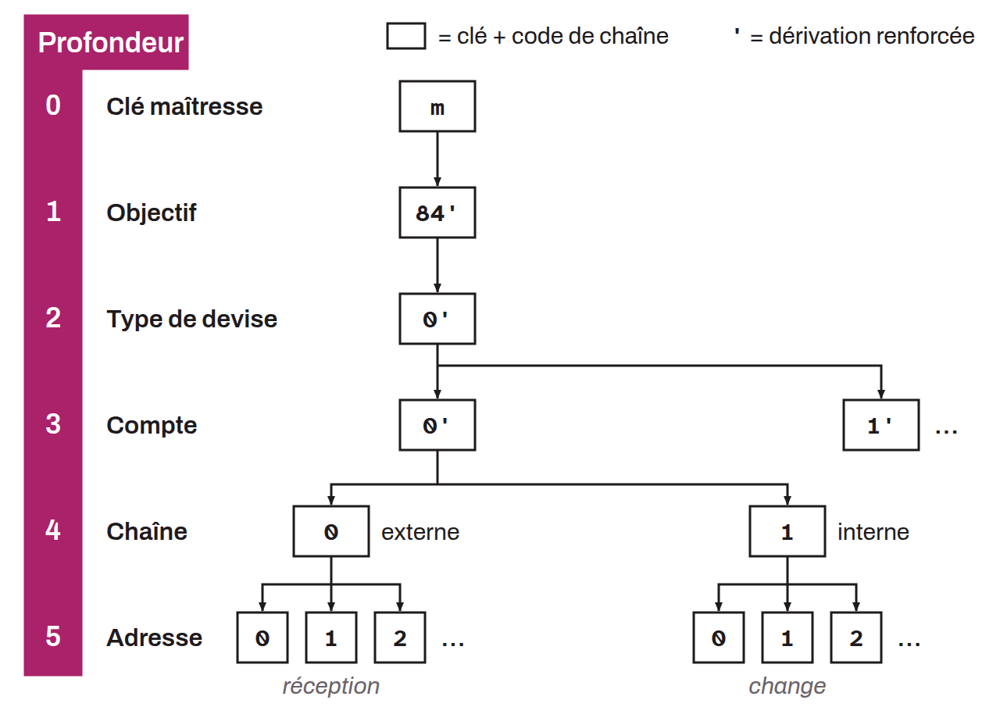

Level of a key (public or private), chain code, extended key, or address in the derivation structure of a hierarchical deterministic (HD) wallet, counted from the master key. Each level of this structure can be seen as a floor in a tree of keys, where the master key sits at the root (depth 0) and the following levels define various attributes such as: the purpose (depth 1), the coin type (depth 2), the account (depth 3), the chain type (depth 4), and the index of the specific address (depth 5).

Moving from one depth to the next uses a derivation process from a parent key pair to a child key pair.
