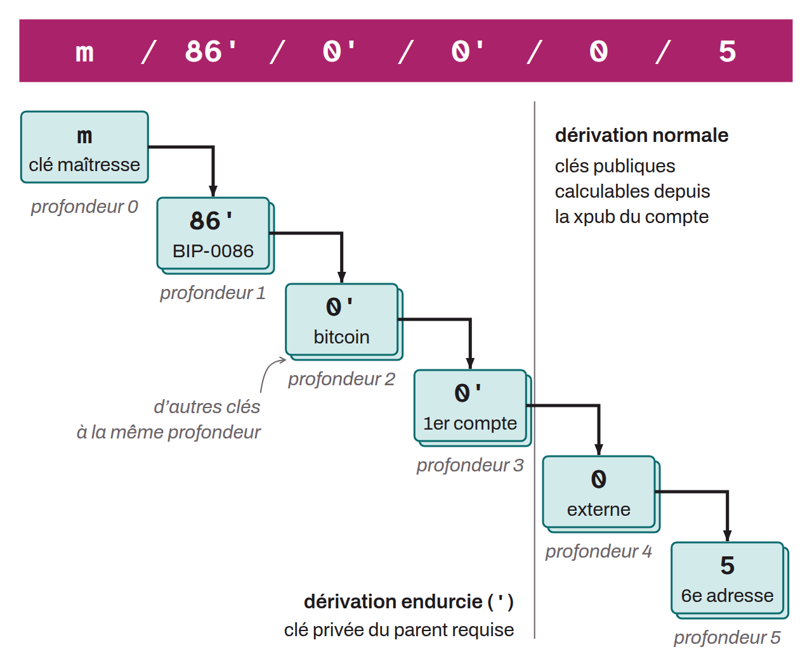

In hierarchical deterministic (HD) wallets, the sequence of indexes used to derive child keys from a master key. Described in BIP-0032, this path identifies the tree structure of child key derivation. A derivation path is written as a series of indexes separated by slashes, and always starts with the master key (written `m/`). For example, a typical path could be `m/84'/0'/0'/0/0`. Each level of derivation is associated with a specific depth:
* `m /` is the master private key. It is unique to a wallet and cannot have siblings at the same depth. The master key is derived directly from the seed;
* `m / purpose' /` is the derivation purpose, which identifies the standard being followed. This field is described in BIP-0043. For example, if the wallet follows the BIP-0084 standard (SegWit v0), the index is `84'`;
* `m / purpose' / coin-type' /` is the type of cryptocurrency. It separates the branches dedicated to one cryptocurrency from those dedicated to another in a multi-coin wallet. The index for bitcoin is `0'`;
* `m / purpose' / coin-type' / account' /` is the account number. This depth makes it easy to separate and organize a wallet into several accounts. Accounts are numbered starting from `0'`. Each node of the tree is an extended key (`xpub`, `xprv`...) according to BIP-0032, but the one usually exported is the one at this depth, the account's extended key;
* `m / purpose' / coin-type' / account' / change /` is the chain. Each account as defined at depth 3 has two chains at depth 4: an external chain and an internal chain (also called "change"). The external chain derives addresses meant to be shared publicly, that is, the addresses offered when "Receive" is clicked in the wallet software. The internal chain derives addresses meant not to be shared publicly, mainly change addresses. The external chain is identified by index `0` and the internal chain by index `1`. Note that from this depth on, the derivation is no longer hardened but normal (there is no apostrophe). This is what makes it possible to derive all the child public keys from their `xpub`;
* `m / purpose' / coin-type' / account' / change / address-index` is simply the number of the receiving address and of its key pair, which distinguishes it from its siblings at the same depth on the same branch. For example, the first derived address has index `0`, the second address has index `1`, and so on.

For example, if a receiving address has the derivation path `m / 86' / 0' / 0' / 0 / 5`, the following can be deduced:
* `86'` indicates that the derivation standard of BIP-0086 (Taproot / SegWit v1) is followed;
* `0'` indicates that it is a Bitcoin address;
* `0'` indicates that it is in the first account of the wallet;
* `0` indicates that it is an external address;
* `5` indicates that it is the sixth external address of this account.

