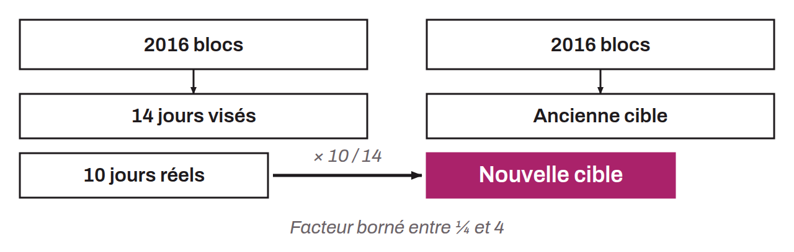
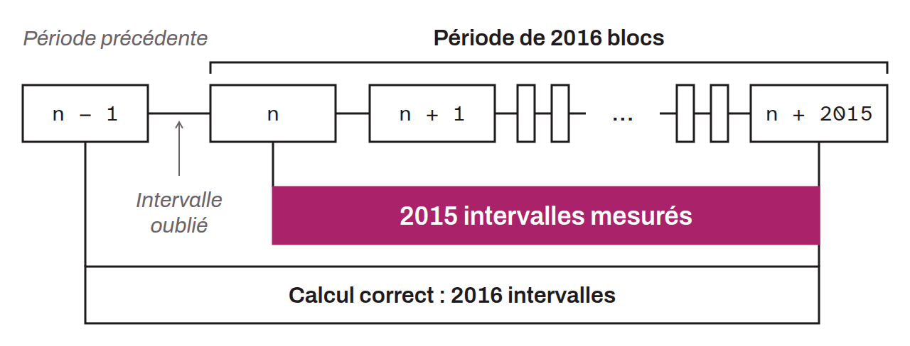

Periodic process that recalculates the difficulty target for the proof-of-work mechanism (mining) on Bitcoin. This event occurs every 2,016 blocks (about every two weeks). It raises or lowers the difficulty factor (also called the difficulty target), depending on how quickly the last 2,016 blocks were found. The adjustment aims to keep block production stable and predictable, at a rate of one block every 10 minutes, despite variations in the computing power deployed by miners. The change in difficulty at each adjustment is limited to a factor of 4. The formula that nodes apply to compute the new target is:
$$N = A \cdot \left(\frac{T}{1\,209\,600}\right)$$

Where:
* $N$: the new target;
* $A$: the old target;
* $T$: the time elapsed between the first and the last block of the period, in seconds;
* $1\,209\,600$: the target time in seconds for 2,016 blocks at 10-minute intervals ($2016 \times 600$).

Because of an off-by-one bug introduced by Satoshi Nakamoto, $T$ measures the duration of 2,015 block intervals, not 2,016. The calculation compares the timestamp of the first block of the period (block $n$) with that of the last (block $n + 2015$), which covers only 2,015 intervals. A correct calculation would have compared the last block of the previous period (block $n - 1$) with the last block of the current period (block $n + 2015$), that is, 2,016 intervals. This bug introduces a bias of about 0.05% toward a difficulty slightly higher than it should be. It is mainly what makes the time warp attack feasible, because retarget periods do not overlap.

