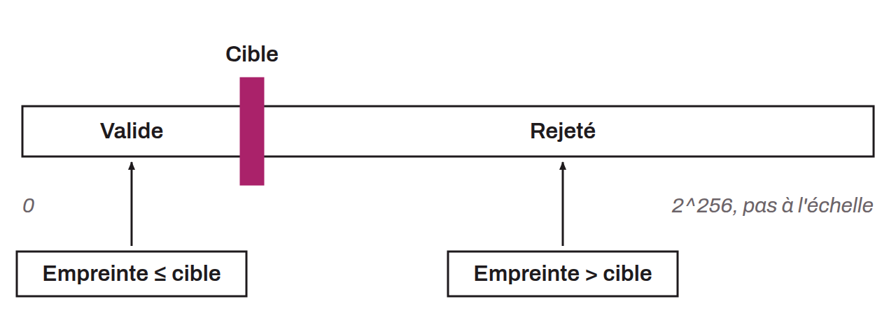

Parameter used in the proof-of-work (PoW) consensus mechanism on Bitcoin, also known as the difficulty factor. The target is a numerical value that determines how hard it is for miners to solve a specific cryptographic problem, called proof of work, when creating a new block on the blockchain.

The difficulty target is an adjustable 256-bit (32-byte) number that sets an acceptability limit for the hash of the block header. In other words, for a block to be valid, the hash of its header with `SHA256d` (double `SHA256`) must be numerically less than or equal to the difficulty target. The proof of work consists of modifying the `nonce` field of the block header or of the coinbase transaction until the resulting hash is below the target value.

This target is adjusted every 2016 blocks (about every two weeks), in an event called the “adjustment”. The difficulty factor is recomputed based on the time it took to mine the previous 2016 blocks. If the total time is less than two weeks, the difficulty increases by adjusting the target downward. If the total time is more than two weeks, the difficulty decreases by adjusting the target upward. The goal is to keep the average mining time per block at 10 minutes. This spacing between blocks helps avoid splits of the Bitcoin network, which waste computing power. The difficulty target is found in each block header, in the `nBits` field. Since this field is limited to 32 bits and the target is actually 256 bits, the target is compacted into a less precise scientific format.

*The difficulty target is sometimes also called the “difficulty factor”. By extension, it can be referred to through its encoding in block headers with the term “nBits”.*
