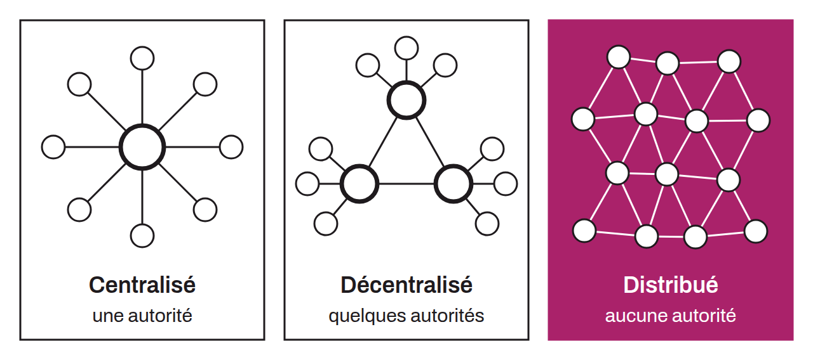

Property of a computer network in which decision-making power and control are shared equally among all the network's participants. This distribution guarantees the system's resilience. Such a network is also called a peer-to-peer network. Unlike a decentralized network, where power is fragmented and dispersed among several entities but some central authorities retain more power than the users, a distributed network eliminates the central authority by entrusting management and control to the users themselves. Bitcoin is an example of a distributed system. Bitcoin has no hierarchy or central authority. Maintaining consensus, verifying transactions, and issuing new monetary units are carried out by the users. This distributed structure ensures the system's resilience and censorship resistance, making it very hard for a single entity to control or manipulate it.

*Some people call Bitcoin a decentralized system, and the two terms are often used interchangeably. A more evocative synonym of "distributed" is "peer-to-peer," sometimes abbreviated "P2P."*
