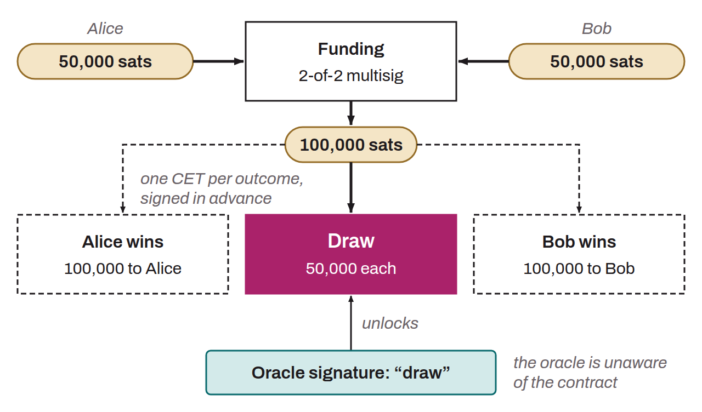

Type of smart contract on Bitcoin that executes contractual conditions based on the outcome of external events, attested by one or more oracles, without the oracles knowing the details of the contract. DLCs were invented by Tadge Dryja in 2017. These smart contracts are mainly useful in financial applications, making it possible, for example, to create financial instruments or conditional bets while reducing counterparty risk. To build a DLC, two parties lock bitcoin in a 2-of-2 multisig address. This bitcoin is unlocked when the oracle publishes the specified information at a given time; if the oracle publishes nothing, a refund transaction, timelocked until an agreed date, returns each party's stake.

