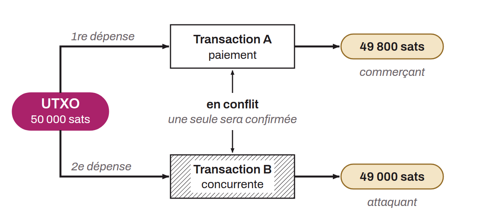

Attack in which a malicious user attempts to use the same UTXO (unspent transaction output) more than once in order to profit at the expense of the counterparties of the transactions involved. In principle, once a transaction is confirmed in a block and added to the blockchain, the use of those bitcoin is permanently recorded, preventing any later spend of those same bitcoin. Preventing double spending is in fact the blockchain's primary purpose.

In a double-spend attack, the attacker first makes a legitimate transaction to a merchant, then creates a second, competing transaction that spends the same coins, either by sending them back to themselves to recover the amount or by using them to buy another good or service from another merchant.

Two main scenarios can enable this attack. The first, and the simplest for the attacker, is to execute the fraudulent transaction before the legitimate transaction is included in a block. To get the fraudulent transaction confirmed first, the attacker attaches much higher transaction fees than on the legitimate one. This is a sort of fraudulent RBF. This scenario is possible only if the merchant agrees to complete the sale with “zeroconf,” that is, with no confirmation at all for the payment transaction. This is why it is strongly recommended to wait for several confirmations before considering a transaction immutable. The second scenario, much more complex, is that of a 51% attack. If the attacker controls a large share of the network's computing power, the attacker can mine a chain competing with the one containing the legitimate transaction but including the fraudulent one. Once the merchant has accepted the sale and the attacker has managed to create a longer chain (with more accumulated work) than the legitimate chain, the attacker can then broadcast the fraudulent chain, which the network's nodes will recognize as the valid one.
