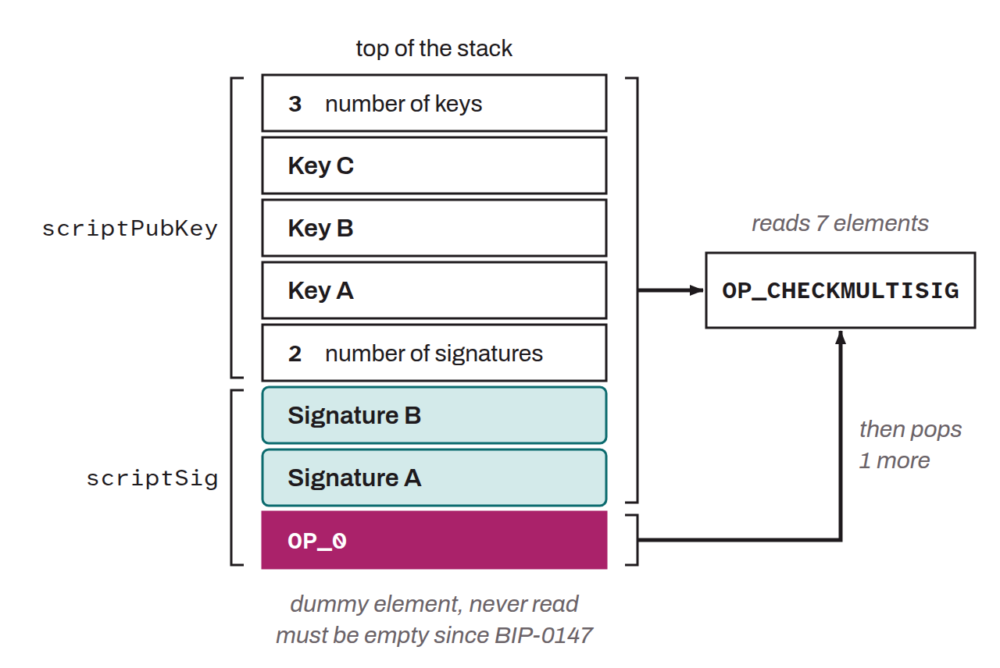

Extra, useless element consumed by the `OP_CHECKMULTISIG` and `OP_CHECKMULTISIGVERIFY` opcodes when verifying the signatures in a transaction. Because of a historical off-by-one bug, these 2 opcodes remove an extra element from the stack in addition to their basic function. To avoid an error, it is therefore mandatory to include a dummy value at the start of the `scriptSig` to satisfy the removal and work around the bug. This useless value is what is known as the “dummy element.” BIP-0011, which introduced the P2MS standard, advised putting an `OP_0` as the useless value. But this standard was not enforced at the consensus level, meaning any value could be placed there without invalidating the transaction. The dummy element was therefore a transaction malleability vector. BIP-0147, introduced with the SegWit soft fork, required this dummy element to be strictly an empty byte array (`OP_0`), eliminating the malleability tied to this element by making any non-conforming transaction invalid under the consensus rules. This rule, named `NULLDUMMY`, applies to both SegWit and pre-SegWit transactions.

