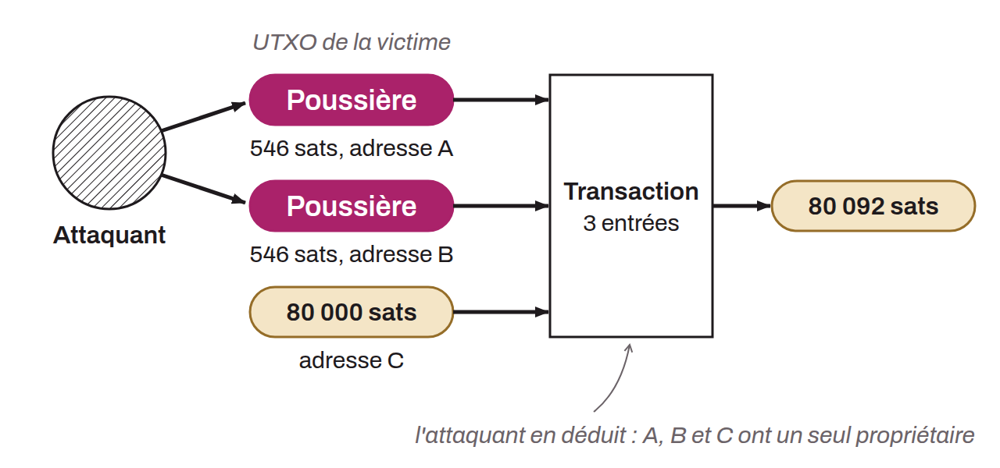

Attack that consists of sending tiny amounts of bitcoin to a large number of receiving addresses. The attacker's goal is to push the recipients to combine these amounts with other UTXOs. The attacker then tracks the future movements of these small amounts of bitcoin, with the aim of forming clusters of addresses, that is, determining whether several addresses belong to the same entity. By cross-referencing the information gathered in a dusting attack with other data and heuristics used in chain analysis, the attacker can identify certain entities and their associated addresses. This method is a threat only to users' privacy and does not affect the security of their funds.

*Some bitcoiners suggest no longer using the term “dusting attack” because it would be misleading. The term “dust” describes something very specific in Bitcoin Core. If a dusting attack really used dust as defined in Core, the attack would be ineffective. Some therefore suggest the term “forced address reuse” to describe the attack more precisely.*
