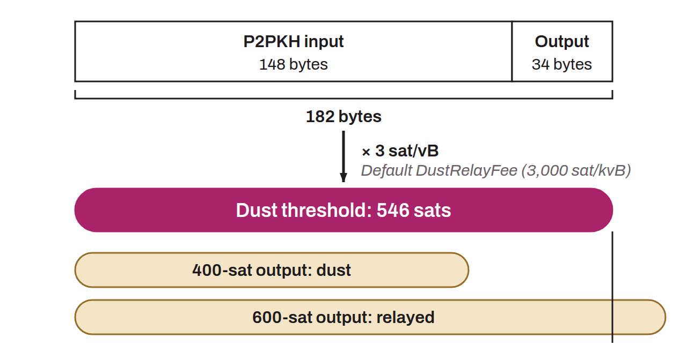

Standardness rule used by network nodes to determine what they consider the “dust limit.” This parameter sets a fee rate in sats per virtual kilobyte (sats/kvB) that serves as a reference to calculate whether a UTXO's value is lower than the fees needed to include it in a transaction. A UTXO is considered “dust” on Bitcoin if it requires more fees to be transferred than the value it represents. The limit is calculated as follows:

```text
limit = (input size + output size) * fee rate
```

Because the fee rate required for a transaction to be included in a Bitcoin block varies constantly, the `DustRelayFee` parameter lets each node define the fee rate used in this calculation. By default, on Bitcoin Core, this value is set to 3,000 sats/kvB. For example, to calculate the dust limit for a P2PKH input and output, which measure 148 and 34 bytes respectively, the calculation would be:



```text
limit (sats) = (148 + 34) * 3000 / 1000 = 546 sats
```

This means that the node in question will not relay transactions that include a P2PKH UTXO whose value is below 546 sats.
