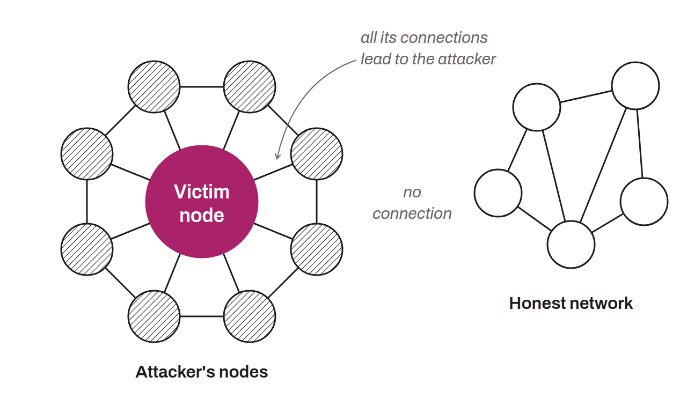

Attack that consists of isolating a node in a network and controlling its communications by creating an artificial environment around it. The goal is to filter or manipulate the information the node receives and sends, thereby cutting it off from its legitimate peers. In the context of Bitcoin, this technique can be used to mislead a node, to censor or alter the data it receives or sends, or to carry out double-spend attacks.

