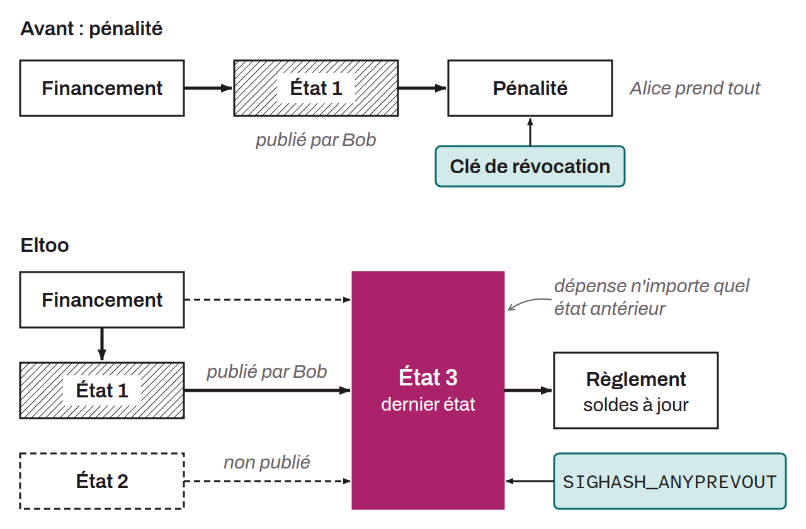

General-purpose protocol for Bitcoin layer 2s that defines how to jointly manage ownership of a UTXO. Eltoo was designed by Christian Decker, Rusty Russell, and Olaoluwa Osuntokun, notably to solve the problems associated with the mechanisms for negotiating the state of Lightning channels, that is, between opening and closing. The Eltoo architecture simplifies the negotiation process by introducing a linear state management system, replacing the penalty-based approach with a more flexible and less punitive update method. This protocol requires a new type of SigHash that lets the signature of an input avoid committing to the specific UTXO that this input spends. This SigHash was first called `SIGHASH_NOINPUT`, then `SIGHASH_ANYPREVOUT` (Any Previous Output). Its implementation is planned in BIP-0118.

*Eltoo is sometimes also called “LN-Symmetry.”*
