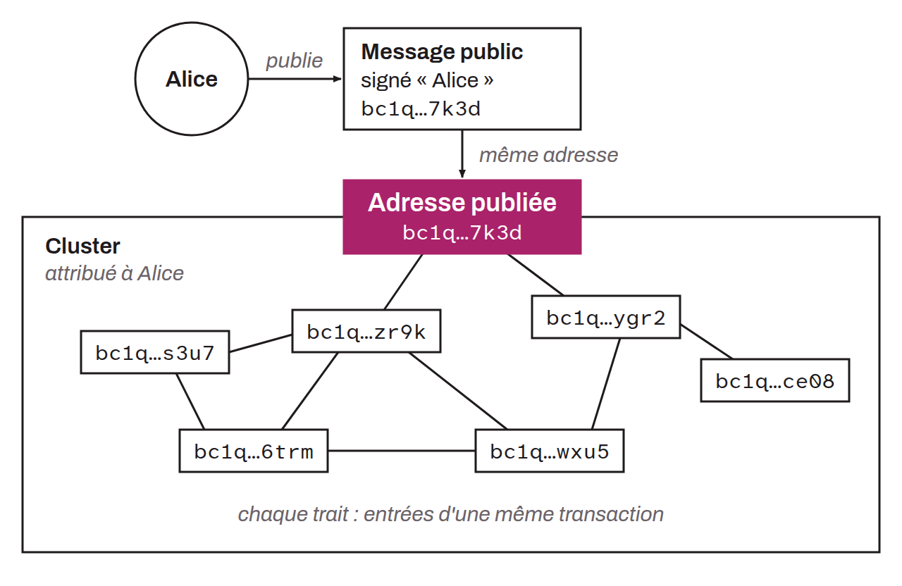

Piece of information that links on-chain activity (an address, a transaction, a cluster...) to an identity belonging to a user or an entity. For example, if a user publishes their receiving address on Twitter under their own name, an analyst could find it and associate it with that identity. In this case, the tweet would be an entry point for a chain analysis. To identify an entry point, analysts can use OSINT, but the most common method of associating on-chain activity with an identity remains KYC.

