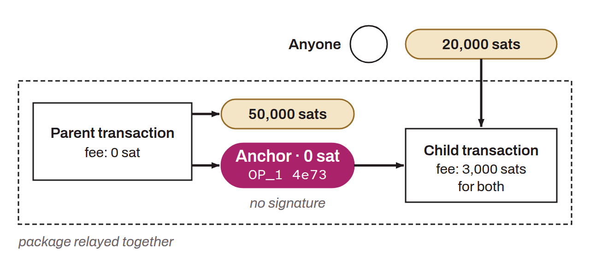

Relay policy that allows zero-fee transactions to be propagated across the network, provided they are accompanied by a child transaction that pays sufficient fees for both. The parent transaction contains a zero-value output with an anyone-can-spend script, which lets any participant on the network create a child transaction that spends this ephemeral output and attaches the appropriate fees at broadcast time.

This mechanism solves a fundamental problem of contract protocols like the Lightning Network: transactions are signed by the participants well before they are broadcast, which makes it impossible to determine in advance a fee rate suited to network conditions. Ephemeral anchors defer the choice of fees to publication time, offering a form of “fee sponsorship” open to any party, whether or not it is a beneficiary of the transaction's other outputs.

This mechanism relies on the relay rules for v3 transactions (TRUC) and on package relay. It is an evolution of the traditional anchor outputs of the Lightning Network, themselves based on the CPFP carve-out rule. Bitcoin Core 28.0 introduced the TRUC rules and the standard Pay-To-Anchor (P2A) output type for this mechanism, and Bitcoin Core 29.0 then added the ephemeral dust rule, which admits an output below the dust threshold in a zero-fee transaction. Ephemeral anchors are also an effective countermeasure against transaction pinning attacks.
