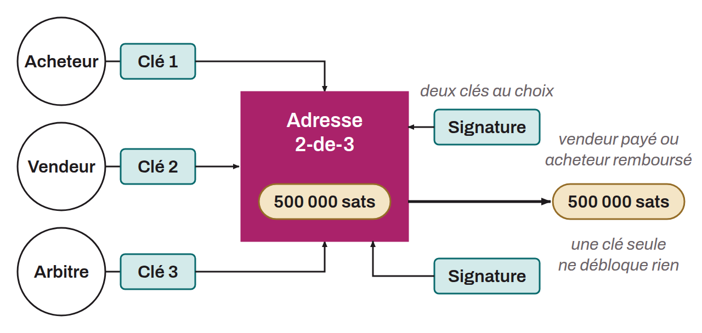

Mechanism by which funds are entrusted to a trusted third party that holds them until the conditions agreed between the parties are met. Escrow is commonly used in commercial transactions to protect both buyer and seller.

In the context of Bitcoin, escrow can be implemented in different ways. The most common method uses 2-of-3 multisig addresses, in which three keys are distributed among the buyer, the seller, and an arbitrator. The funds can be unlocked only if at least two of the three parties sign the transaction, which allows dispute resolution without any single party controlling the funds.

Timelocks can also be built in to ensure the funds do not stay locked indefinitely. On-chain escrow is used notably by peer-to-peer exchange platforms such as Bisq or HodlHodl to secure transactions without a centralized third party.
