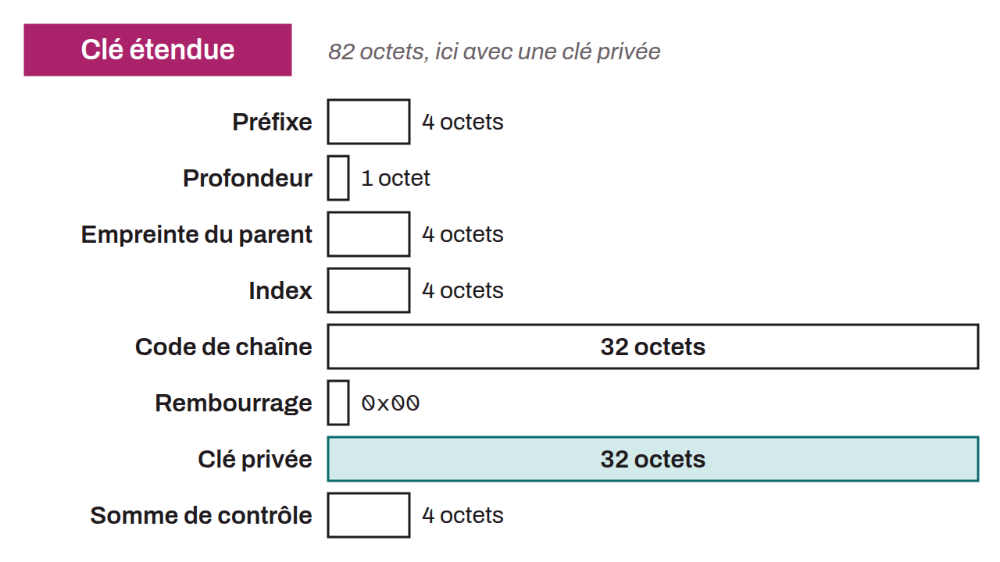

String of characters that combines a key (public or private), its associated chain code, and a series of metadata. An extended key gathers in a single identifier all the elements needed to derive child keys. Extended keys are used in hierarchical deterministic wallets, and come in two types: an extended public key (used to derive child public keys) or an extended private key (used to derive both child private keys and child public keys). An extended key thus includes several different pieces of data, described in BIP-0032, in this order:
* The prefix: 4 version bytes (`0x0488B21E` for an extended public key and `0x0488ADE4` for an extended private key on Bitcoin, according to BIP-0032). Once the key is encoded in Base58Check, these bytes give a readable prefix (not an HRP, a notion specific to Bech32): `prv` and `pub` indicate whether it is an extended private key (`prv`) or an extended public key (`pub`). The first letter of the prefix designates the version of the extended key: `x` for Legacy or SegWit v1 on Bitcoin, `t` for Legacy or SegWit v1 on Bitcoin testnet, `y` for Nested SegWit on Bitcoin, `u` for Nested SegWit on Bitcoin testnet, `z` for SegWit v0 on Bitcoin, `v` for SegWit v0 on Bitcoin testnet.
* The depth, which indicates the number of derivations from the master key to the extended key;
* The parent fingerprint. This is the first 4 bytes of the `HASH160` of the parent public key;
* The index. This is the number of the pair, among its siblings, from which the extended key comes;
* The chain code;
* A padding byte `0x00` if it is a private key;
* The private key or the public key;
* A checksum. This is the first 4 bytes of the `HASH256` of all the rest of the extended key.

In practice, the extended public key is used to generate receiving addresses and to watch the transactions of an account, without exposing the associated private keys. This can allow, for example, the creation of a so-called “watch-only” wallet. It is important to note, however, that the extended public key is sensitive information for the user's privacy, since disclosing it can allow third parties to trace the transactions and see the balance of the associated account.
