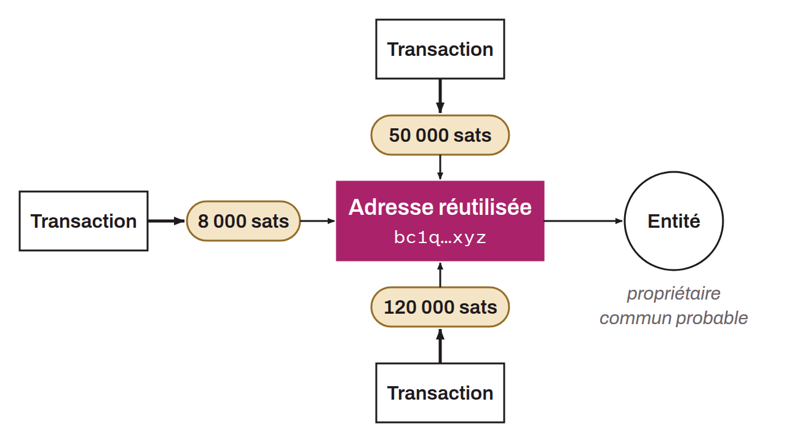

Address reuse is said to be "external" when it occurs across several different transactions. In this configuration, external address reuse is a chain analysis heuristic that supports a plausible assumption that all UTXOs received on this address belong to the same entity.

