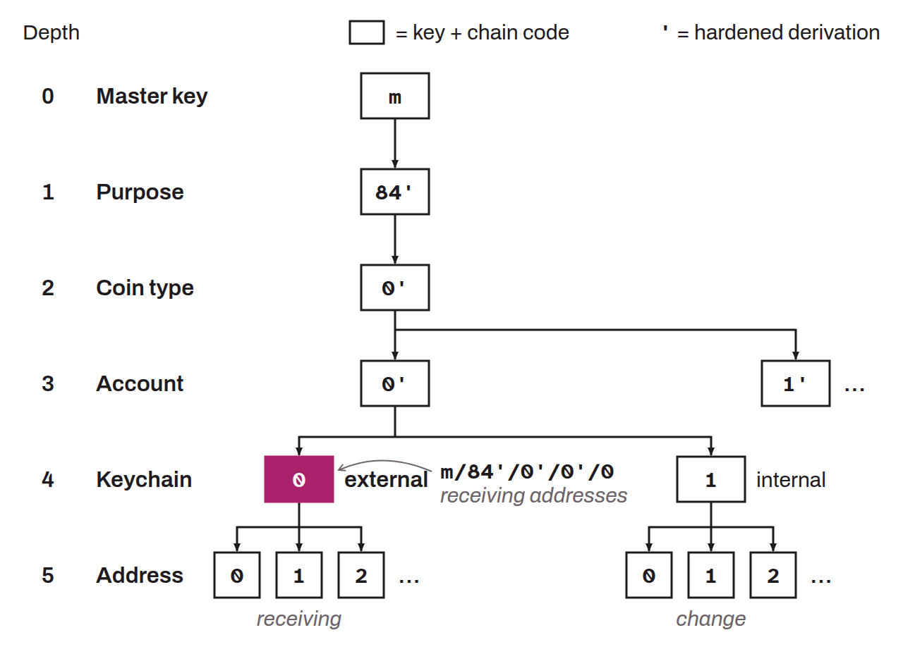

In the derivation of hierarchical deterministic wallets, derivation branch used to generate receiving addresses meant to receive payments from outside, that is, from another wallet. Each account, as defined at depth 3, has two keychains at depth 4: an external keychain and an internal keychain (also called “change”). The external keychain is derived with an index of `/0/`. It derives addresses meant to be shared publicly, that is, the addresses offered when the “receive” button is clicked in wallet software.

