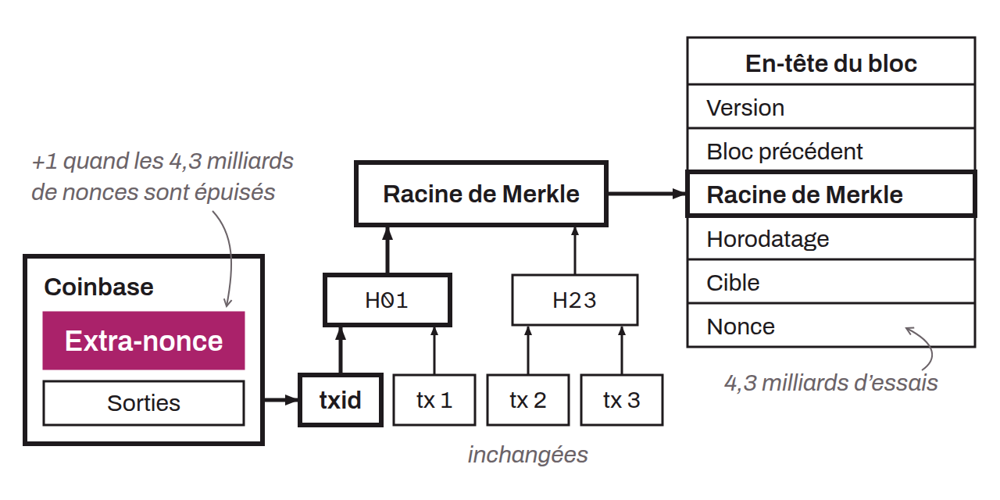

Field used in the `scriptSig` of a block's coinbase transaction, which provides a larger number of possibilities to try in order to find a hash lower than or equal to the difficulty target, in addition to the classic nonce located directly in each block's header.

Changing the extra-nonce in the coinbase transaction changes the ID of that transaction, and therefore the Merkle root of all the block's transactions, which also modifies the block header. This lets the miner keep searching for hashes once the range of the classic nonce is exhausted, without changing the structure of their candidate block.

In mining pools, the extra-nonce is often split into two parts: one generated by the pool to identify each hasher, and another modified by the hasher in its search for a valid share. This lets the different hashers of the pool work simultaneously on the same candidate block with the full range of nonces, without duplicating the same work at the pool level.
