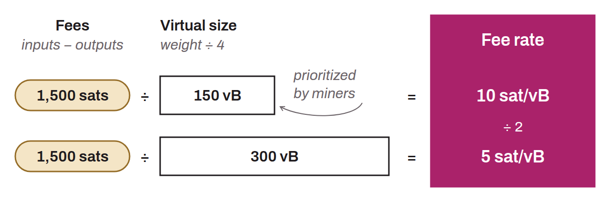

Measure of the unit cost of a Bitcoin transaction's fees, expressed in satoshis per virtual byte (sat/vB). The fee rate determines a transaction's priority in the mempool: the higher the rate, the more miners are incentivized to include it quickly in a block. The absolute amount of the fees is the difference between the total of the inputs and the total of the outputs of a transaction. The fee rate is obtained by dividing this amount by the transaction's virtual size (its weight in weight units divided by 4):
$$fee\ rate\ (sats/vB) = \frac{fees\ (sats)}{virtual\ size\ (vB)}$$

This rate is freely chosen by the sender of the transaction and works as an auction mechanism. During congestion, the minimum fee rate for a transaction to be included in a block rises.
