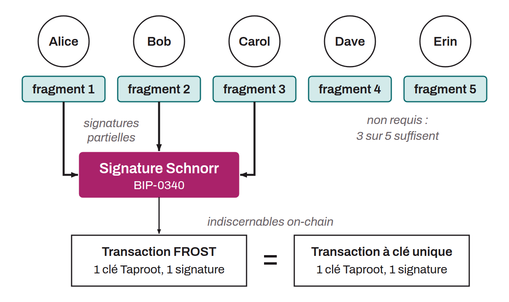

Schnorr threshold signature protocol proposed by Chelsea Komlo and Ian Goldberg in 2020, whose acronym stands for *Flexible Round-Optimized Schnorr Threshold Signatures*. FROST optimizes collaborative signing by reducing it to two rounds of communication between the participants, or even a single round when the nonces are preprocessed.

The protocol relies on a (t, n) threshold scheme: among n participants who each hold a share of the private key, at least t of them must cooperate to produce a valid signature. The resulting signature is a standard Schnorr signature compliant with BIP-0340, indistinguishable from a signature produced by a regular payment. This property is particularly valuable in the context of Taproot, because it makes on-chain multisignature operations possible without revealing the underlying threshold structure, which improves privacy and reduces transaction fees.

