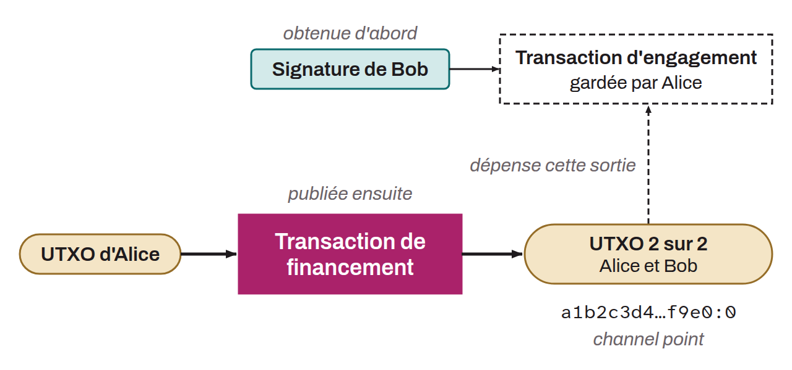

On-chain Bitcoin transaction that marks the opening of a payment channel on the Lightning Network. It sends funds to a 2-of-2 multisig address jointly controlled by the two parties of the channel. These funds make up the total capacity of the channel and can be spent only if both participants sign together.

Before publishing the funding transaction on the blockchain, the channel initiator builds it without broadcasting it, along with the commitment transactions of both parties. Each peer then keeps its commitment signed by the other, and the initiator broadcasts the funding transaction only after receiving its peer's signature. This precaution guarantees that the initiator can recover its funds even if its peer becomes uncooperative. The channel opens once the funding transaction is confirmed by the requested number of blocks (`minimum_depth`) and the `channel_ready` message has been exchanged by both sides. Its output identifier (`txid:output_index`), called the channel point in LND, serves as a unique reference to identify the channel throughout its lifetime.

