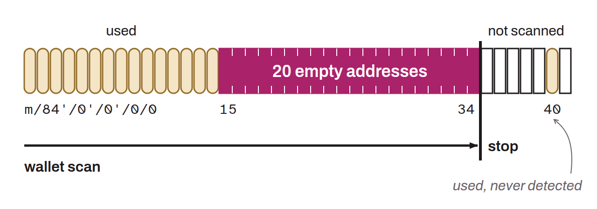

Parameter used in Bitcoin wallet software to set the maximum number of consecutive unused addresses to generate before it stops searching for further transactions. Adjusting this parameter is often necessary when recovering a wallet, to make sure all transactions are found. A gap limit that is too low could cause some transactions to be missed if addresses were skipped during the derivation phases. Raising the gap limit lets the wallet search further along the sequence of addresses, in order to recover all the associated transactions.

A single `xpub` can theoretically derive more than 4 billion receiving addresses (internal and external addresses). Wallet software cannot derive all of them and check whether they were used without an enormous operational cost. It therefore proceeds in index order, because that is normally the order in which all wallet software generates addresses. The software records each used address before moving on to the next one, and it stops searching when it meets a given number of consecutive empty addresses. That number is the gap limit.

If, for example, the gap limit is set to `20` and the address `m/84'/0'/0'/0/15/` is empty, the wallet derives addresses up to `m/84'/0'/0'/0/34/`. If that range of addresses stays unused, the search stops there. As a result, a transaction using the address `m/84'/0'/0'/0/40/` would not be detected in this example.

