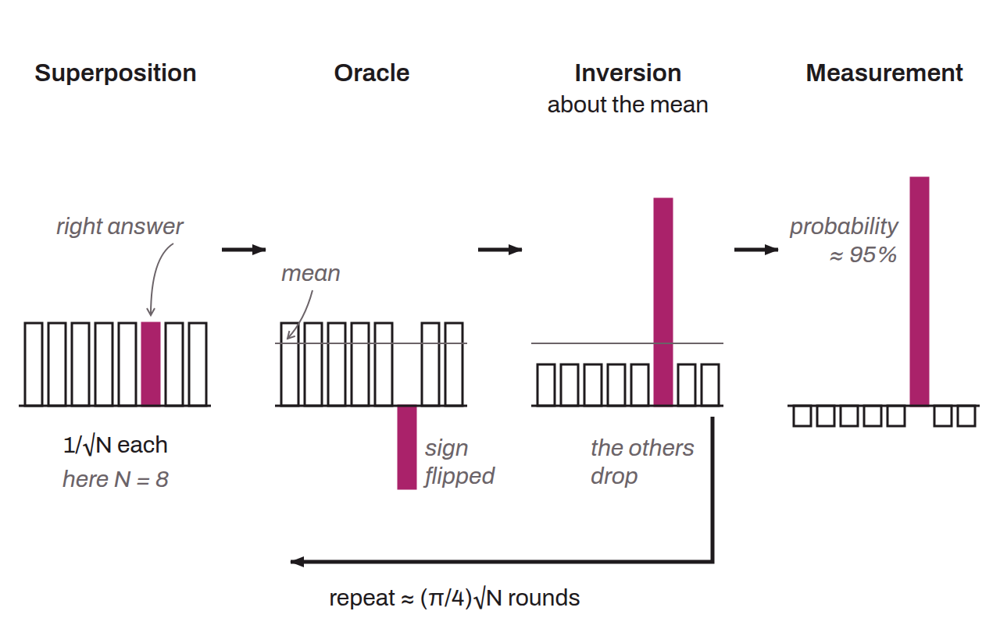

Quantum algorithm published in 1996 by Lov Grover, a researcher at Bell Labs, that finds the element satisfying a condition among $N$ unordered possibilities in a number of evaluations on the order of $\sqrt{N}$, where a classical computer must examine $N/2$ on average. It thus speeds up any brute-force search, but only quadratically: a search among $2^{256}$ possibilities still takes on the order of $2^{128}$ evaluations. On Bitcoin, it concerns hash functions and proof of work, whereas ECDSA and Schnorr signatures are threatened by Shor's algorithm, which solves the discrete logarithm exponentially faster than a classical computer.

Grover illustrates the problem with a phone directory of $N$ names in random order, in which the goal is to look up a person's number: a classical computer must read $N/2$ entries to have a 1-in-2 chance of finding it. The quantum computer, for its part, puts its qubits in a superposition of all the entries, each with the same amplitude $1/\sqrt{N}$, then repeats a loop of two operations. The oracle tests the condition and flips the sign of the amplitude of the single state that satisfies it. An “inversion about the mean” then reflects each amplitude about the average of all of them, which lifts the marked state, now negative, above the others. As long as the amplitude of the right answer stays small, each round increases it by about $1/\sqrt{N}$; after about $\frac{\pi}{4}\sqrt{N}$ rounds, a measurement returns it almost certainly.

Against a hash function, the oracle checks whether an input produces the targeted hash, which forces it to compute the function itself on qubits. To find a preimage of a `SHA256` hash among $2^{256}$ possible values, brute force takes on the order of $2^{255}$ attempts and Grover on the order of $2^{128}$. According to the report published by Chaincode in May 2025, the security of `SHA256` and `RIPEMD160` comes out weakened but not broken, and Bitcoin Optech notes that this loss is offset by moving to an algorithm that offers twice as many bits of security, for example from `SHA256` to `SHA512`. The real cost also exceeds the simple count of evaluations: in 2016, Matthew Amy and his coauthors estimated the circuit for this attack at about $2^{12.6}$ logical qubits (some 6,000 reliable qubits obtained through error correction) maintained for $2^{153.8}$ correction cycles, which by their estimate is up to 275 billion times more expensive than the number of evaluations suggests.

The same report describes as relatively quantum-resistant the addresses that contain only a hash of a public key or script (P2PKH, P2SH, P2WPKH, P2WSH), as long as the key has not been revealed: before applying Shor's algorithm, an attacker would have to invert the hash with Grover to obtain a public key that produces it. Hashes of 160 bits leave less margin. On Delving Bitcoin, on May 5, 2026, Olaoluwa Osuntokun puts a `RIPEMD160` preimage at $2^{80}$ operations with Grover, against $2^{128}$ for `SHA256`, and proposes replacing the `RIPEMD160` hash of the payment hash that appears in the scripts of Lightning HTLCs (BOLT-03) with a `SHA256` hash.

The main limit of Grover is its sequential nature. Christof Zalka showed in 1997 that it cannot be parallelized any better than by splitting the search space among independent quantum computers: with $S$ machines, each must still perform about $\sqrt{N/S}$ rounds, so 100 times more machines only divide the time by 10, whereas a classical search spreads across machines without loss. NIST recalls this in its post-quantum security criteria: the quantum architectures envisioned when they were written would execute only about $2^{40}$ logical gates in series per year, and a realistic Grover attack must run many small instances in parallel, with a gain less spectacular than the theoretical one.

Mining is also a brute-force search: the miner varies the nonce and other block header fields until it obtains a double `SHA256` less than or equal to the target. In theory Grover brings a quadratic gain there, but a quantum miner would have to compete with ASICs. In 2017, Divesh Aggarwal and his coauthors estimated that a quantum machine with demanding but plausible characteristics would reach 13.8 GH/s, more than 1,000 times less than an ASIC of the time. Chaincode's report concludes that this threat remains limited by physical and economic constraints, while noting that Grover, because it parallelizes poorly, would give a disproportionate advantage to miners with the fastest quantum machines.

Quantum mining also opens up new attacks. In March 2024, Bolton Bailey and Or Sattath described a 51% attack carried out by a single quantum miner with a low hashrate, later presented on the bitcoindev mailing list. On a private chain, this miner manipulates timestamps to multiply the difficulty by a factor $c$: each block there counts $c$ times more work but costs it only $\sqrt{c}$ times more effort thanks to Grover, so that its chain, though shorter, ends up carrying more cumulative work than the honest chain. The attack requires an extremely fast, fault-tolerant quantum computer, probably out of reach in the coming years.

Grover is finally a building block of the algorithm of Gilles Brassard, Peter Høyer, and Alain Tapp (1997), which searches for collisions, that is, two inputs giving the same hash, in fewer evaluations than any classical algorithm, at the price of considerable memory: Osuntokun thus puts a `RIPEMD160` collision at $2^{53}$ operations.

Lov Grover presented his algorithm in May 1996 at STOC, the ACM symposium on the theory of computing. In 1997, Charles Bennett, Ethan Bernstein, Gilles Brassard, and Umesh Vazirani proved that no quantum algorithm does better than on the order of $\sqrt{N}$ steps for an unstructured search, which makes Grover optimal up to a constant. Zalka then showed that it is exactly optimal.
