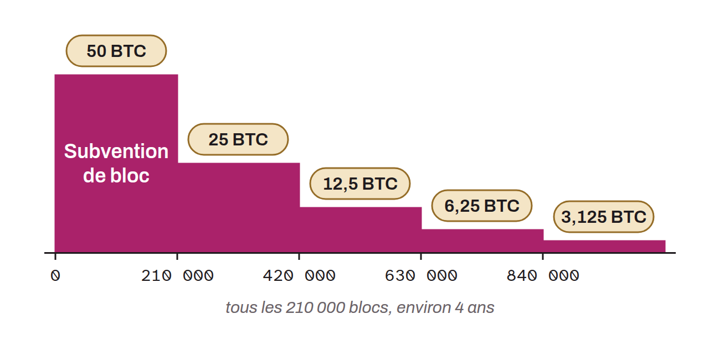

Scheduled event that cuts in half the reward given to miners for each block mined through the block subsidy. The reduction applies specifically to the part of the block subsidy made up of new bitcoin created ex nihilo. The halving was designed by Satoshi Nakamoto, the creator of Bitcoin, as a mechanism to control inflation and ensure a limited supply of bitcoin.

The initial block subsidy was 50 bitcoin, and a halving occurs every 210,000 mined blocks, which takes about four years. The halvings took place:
* At block 210,000 on November 28, 2012, reducing the subsidy to 25 BTC;
* At block 420,000 on July 9, 2016, reducing the subsidy to 12.5 BTC;
* At block 630,000 on May 11, 2020, reducing the subsidy to 6.25 BTC;
* At block 840,000 on April 20, 2024, reducing the subsidy to 3.125 BTC.

Halvings will continue until the block subsidy reaches zero, at which point the maximum supply of about 21 million bitcoin will have been reached. The next Bitcoin halving is expected around spring 2028, although the exact date may vary slightly depending on block times. The block subsidy will then be cut from 3.125 to 1.5625 bitcoin. It will be the fifth halving in Bitcoin's history. As block subsidies fall, transaction fees become an increasingly important source of revenue for miners, which keeps them motivated to continue taking part in proof of work.
