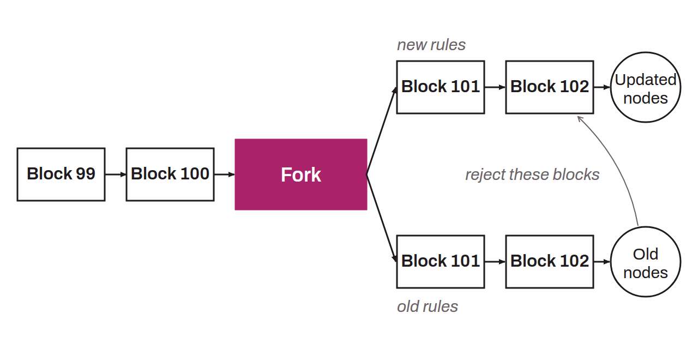

Change to the protocol rules that is not backward compatible. If part of the nodes do not adopt it, the change splits the network of Bitcoin nodes into two distinct groups: the nodes with the update and the nodes without it. The split shows up as the original blockchain dividing into two separate blockchains that still share a common history, hence the term “fork”.

A change is called non-backward-compatible when it is either expanding, meaning that it removes some protocol rules or makes them less restrictive, or bilateral, meaning that it adds rules that are incompatible with the old ones. In other words, a hard fork is observed when some nodes make an invalid block become valid. This produces a new version of the protocol, which can either replace the original Bitcoin if a majority adopts it, or become an independent altcoin if it is used only on the margins. For example, Bitcoin Cash (BCH) is a hard fork of Bitcoin. The fork took place at block 478,559, on August 1, 2017.
