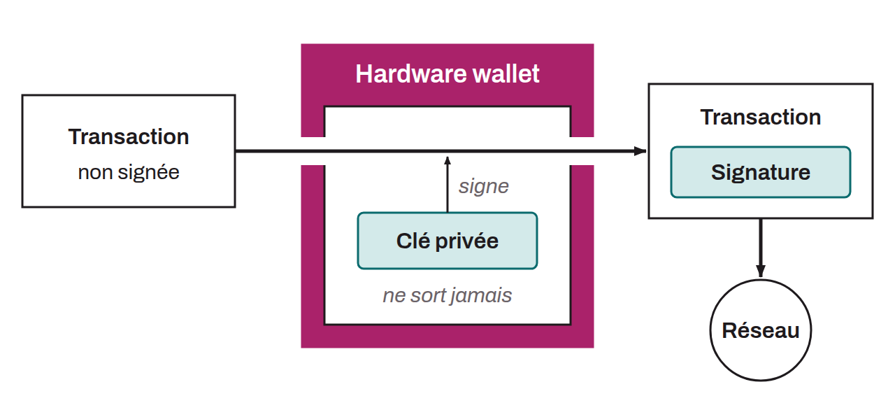

Electronic device dedicated to securing and managing the private keys of a Bitcoin wallet. These devices are designed to provide stronger security than software wallets, which run on general-purpose machines directly connected to the internet. Hardware wallets store the mnemonic phrase offline, on hardware with a minimal attack surface, which isolates it from potentially vulnerable environments. When a transaction is made, the hardware wallet signs it inside the device itself, without exposing the private key to the outside. Once the transaction is signed, it is sent to the Bitcoin network to be confirmed and included in the Bitcoin blockchain. Among the most popular hardware wallet models are Ledger, Trezor, Coldcard, Passport, BitBox, Satochip, Jade, and SeedSigner (non-exhaustive list).

*Some bitcoiners prefer the term “signing device”, to avoid giving the impression that the bitcoin is physically stored in the wallet.*
