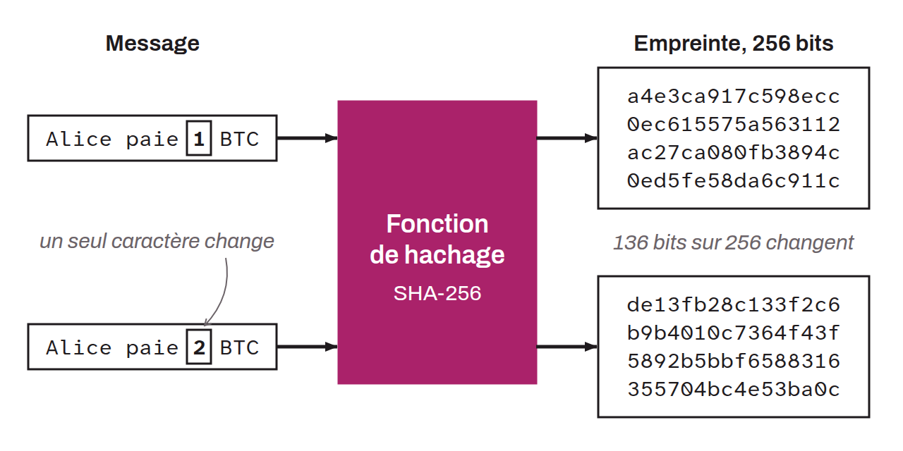

Mathematical function that takes an input of variable size (called a message) and produces an output of fixed size (called a hash or hash digest). Hash functions are widely used cryptographic primitives. They have specific properties that make them suitable for use in secure contexts:
* Preimage resistance: it must be very hard to find a message that gives a specific hash, that is, to find a preimage $m$ for a hash $h$ such that $h = H(m)$, where $H$ is the hash function;
* Second-preimage resistance: given a message $m_1$, it must be very hard to find another message $m_2$ (different from $m_1$) such that $H(m_1) = H(m_2)$;
* Collision resistance: it must be very hard to find two distinct messages $m_1$ and $m_2$ such that $H(m_1) = H(m_2)$;
* Avalanche effect: small changes in the input must cause significant and unpredictable changes in the output.

In the context of Bitcoin, hash functions are used for several purposes, notably the proof-of-work mechanism, transaction IDs, address generation, checksum computation, and the creation of data structures such as Merkle trees. On the protocol side, Bitcoin mainly uses the `SHA256d` function, also called `HASH256`, which consists of a double `SHA256` hash. Addresses rely on `HASH160`, and Taproot uses a single `SHA256`, in its tagged variant (BIP-0340). The Script language also offers the opcodes `OP_SHA256`, `OP_RIPEMD160`, and `OP_HASH160`. `HASH256` is also used in the computation of certain checksums, notably for extended keys (`xpub`, `xprv`...). On the wallet side, the following are also used:
* a single `SHA256` for the checksums of mnemonic phrases;
* `SHA512` within the `HMAC` and `PBKDF2` algorithms used in the derivation process of hierarchical deterministic wallets;
* `HASH160`, which describes the successive use of a `SHA256` and a `RIPEMD160`. `HASH160` is used in the generation of receiving addresses (except P2PK, P2WSH, and P2TR) and in the computation of parent key fingerprints for extended keys.
