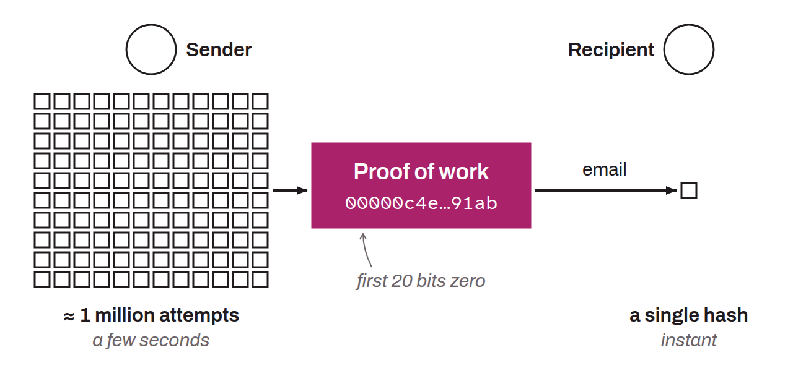

Proof-of-work system designed by Adam Back in 1997 to fight spam and DoS attacks. It relies on the principle that a sender must perform computational work (specifically, finding a partial collision on a cryptographic hash function) to prove they did the work. This task is costly in time and energy for the sender, but the recipient can verify the result quickly and easily. The protocol proved particularly well suited to fighting spam in email, because it places little burden on legitimate users while being a major obstacle for spammers. Sending a single email takes a few seconds of computation, but repeating the operation millions of times becomes extremely expensive in energy and time, which often cancels out the economic appeal of spam campaigns, whether for marketing or malicious purposes. It also preserves the sender's anonymity.

Hashcash was quickly adopted by cypherpunks who were trying to develop an anonymous electronic money system with no intermediary. Adam Back's innovation introduced the notion of scarcity into the digital world for the first time. The concept of proof of work then appears in several electronic money systems that predate Bitcoin, including:
* b-money by Wei Dai, published in 1998;
* RPOW by Hal Finney, published in 2004;
* Bit Gold by Nick Szabo, published in 2005.

The principle of Hashcash is also found in the Bitcoin protocol, where it is used as a protection mechanism against Sybil attacks.
