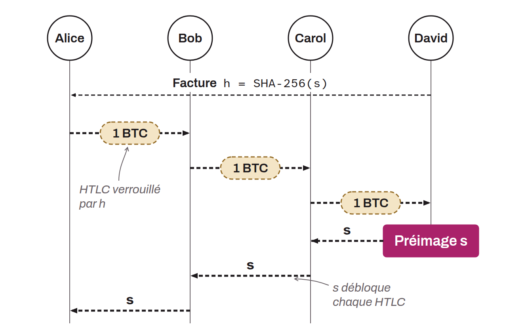

Acronym for *Hashed Time-Locked Contract*. It is a smart contract mechanism used mainly on Lightning, and sometimes found in atomic swaps. An HTLC makes a transfer of funds conditional on a secret being revealed, and also includes a time condition to protect the sender's money if the transfer fails.

On Lightning, HTLCs let a sender pay a node it has no direct channel with, across several channels, with no trust needed along the route. The payment between each pair of nodes is conditional on providing a preimage (the secret that, when hashed, matches an agreed value). If the final recipient provides this preimage, it can claim the funds, which necessarily lets each intermediate node claim the funds too, in a cascade.

For example, if Alice wants to send 1 BTC to David but has no direct channel with him, she has to go through Bob and Carol, who have payment channels between them. Here is how the payment unfolds:
* David presents a Lightning invoice to Alice. It contains the hash $h$ of a secret $s$ (the preimage) that only David knows. So: $h\ =\ hash(s)$;
* Alice creates an HTLC with Bob, offering to send him 1 BTC on condition that Bob provides her with a secret $s$ (the preimage) matching the hash $h$;
* Bob creates an HTLC with Carol, offering to send her 1 BTC on condition that she provides the same secret $s$;
* Carol creates an HTLC with David, again offering 1 BTC if he reveals the preimage $s$;
* David reveals $s$ (which he alone knew) to Carol to receive 1 BTC. Carol can now use $s$ to collect the BTC from Bob. And Bob, who now knows $s$, does the same with Alice.

In the end, Alice has sent 1 BTC to David through Bob and Carol (who can each charge routing fees, left out of this example), without anyone having to trust anyone, because the HTLC conditions secure every step in a cascade.

HTLCs thus enable so-called "atomic" operations: either the transfer fully succeeds, or it fails and the funds are returned. This keeps transactions secure even among several participants, with no need for trust.
