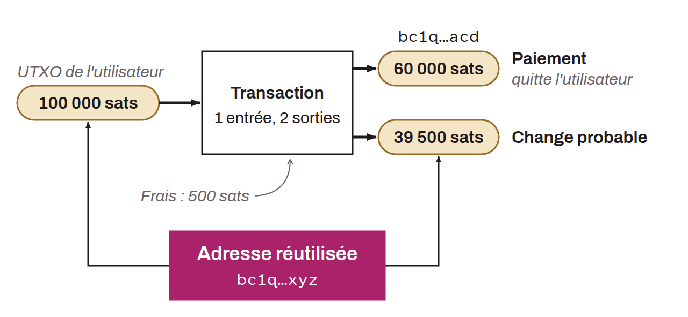

Address reuse is said to be “internal” when it occurs within a single transaction, between an input and an output. In this configuration, internal address reuse is a chain analysis heuristic that supports a plausible assumption about the transaction's change. If there are two outputs and one of them uses the same receiving address as an input, the second output likely leaves the initial user's possession. The output with the reused address likely represents the change.

