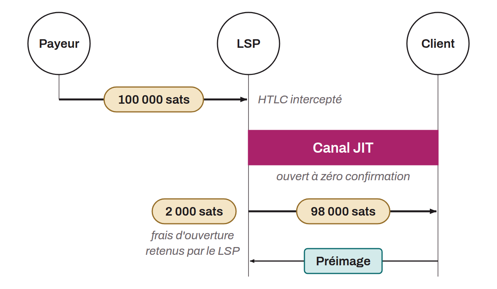

Lightning channel opened on the fly by a Lightning service provider (LSP) when an incoming payment arrives for a client that does not yet have a channel. The term "JIT" (just-in-time) means that the channel is created only at the precise moment it is needed, not in advance.

It relies on the LSPS2 protocol (bLIP-0052). The client asks the LSP for the opening fee parameters, then obtains a temporary short channel ID (SCID) that it includes in its Lightning invoice as a routing hint. When a payer sends the payment, the LSP intercepts the HTLC, opens a zero-confirmation channel to the client, and forwards the payment, deducting the opening fee from the amount received. The client claims the payment by revealing the preimage.

Two trust models exist:
* in the default model, the LSP broadcasts the funding transaction before receiving the preimage, which gives the client the chance to check that it is valid;
* in the alternative model, the client hands over the preimage immediately after the HTLC is committed.

This mechanism should not be confused with JIT routing, which consists of rebalancing existing channels.
