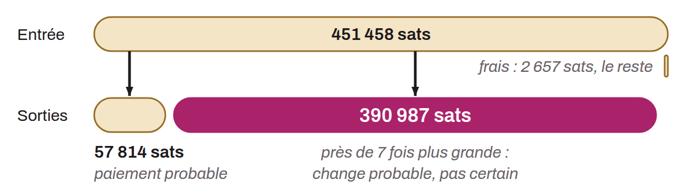

Internal chain analysis heuristic. When a sufficiently wide gap is observed between 2 transaction outputs in a simple payment pattern, the largest output can be estimated to be, in all likelihood, the change. This largest-output heuristic is probably the least precise of all. Identified alone, it is rather weak. However, this characteristic can be combined with other heuristics to reduce the uncertainty of the interpretation.

