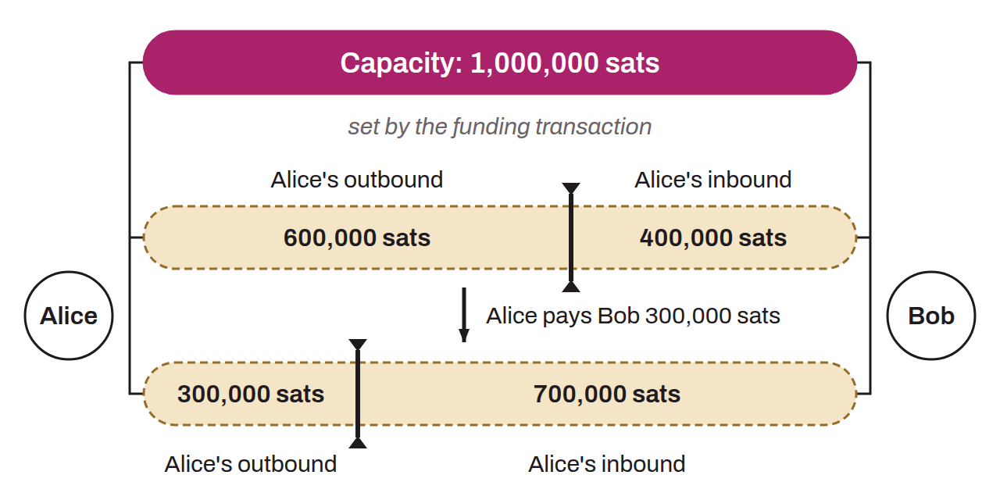

Amount of bitcoin locked in a multisig address that represents a payment channel on the Lightning Network. A channel's capacity is therefore the total amount of sats committed to that specific channel. The portion that can actually be transmitted is smaller: each party must keep a channel reserve (`channel_reserve_satoshis`), and the party that opened the channel pays the fees of the commitment transaction. The capacity is set when the channel is created, as the sum of the funds the parties commit to it, and it can later change through a splice. “Inbound capacity” refers to the maximum amount of bitcoin a node can receive through a channel. “Outbound capacity” is the maximum amount of bitcoin a node can send through a specific channel.

