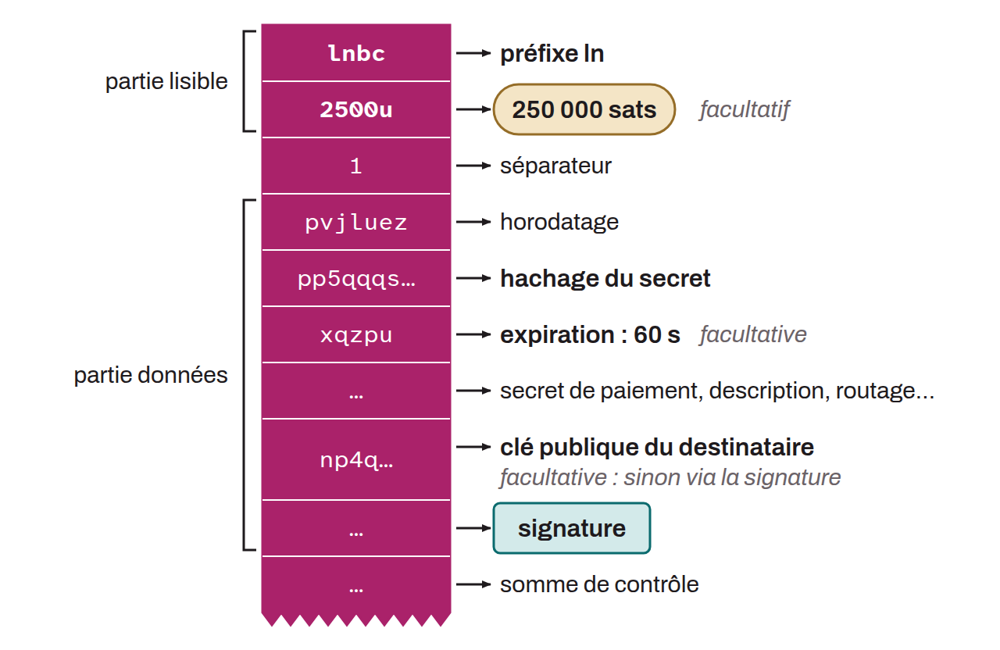

Lightning payment request generated by the recipient, which contains all the information needed to carry out the transaction.

A Lightning invoice contains an `ln` prefix, the hash of the secret used in HTLCs, and other metadata, some of it optional: the amount, a time before expiry (3,600 seconds by default), the public key of the recipient node, which the payer can also recover from the signature, or routing options. These invoices are defined by the BOLT-11 specification.

