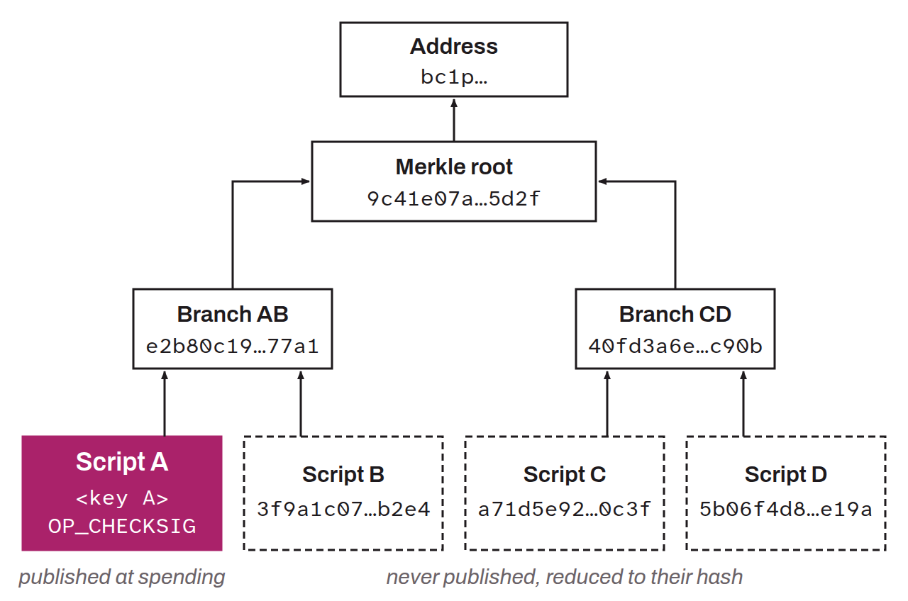

Acronym for *Merklized Alternative Script Trees*. Technique that uses a Merkle tree to summarize an arbitrary number of spending conditions chosen by the user in a receiving address, one of which must be fulfilled to spend the bitcoin concerned. The Merkle tree lets the user choose which condition to fulfill without revealing the details of the other conditions on the blockchain. This reduces the fees for such scripts, makes it possible to create much heavier conditions and, over a longer period, improves the user's privacy (in addition to the joint use of Schnorr). The concept was the subject of several proposals, but it was finally added to Bitcoin through the Taproot soft fork in 2021.

*Originally, “MAST” stood for “Merklized Abstract Syntax Tree”. The way it is used in Taproot no longer has anything to do with an “Abstract Syntax Tree”. However, users kept using the term MAST. Anthony Towns therefore proposed changing the original meaning while keeping the widely used acronym, with “Merklized Alternative Script Trees”.*
