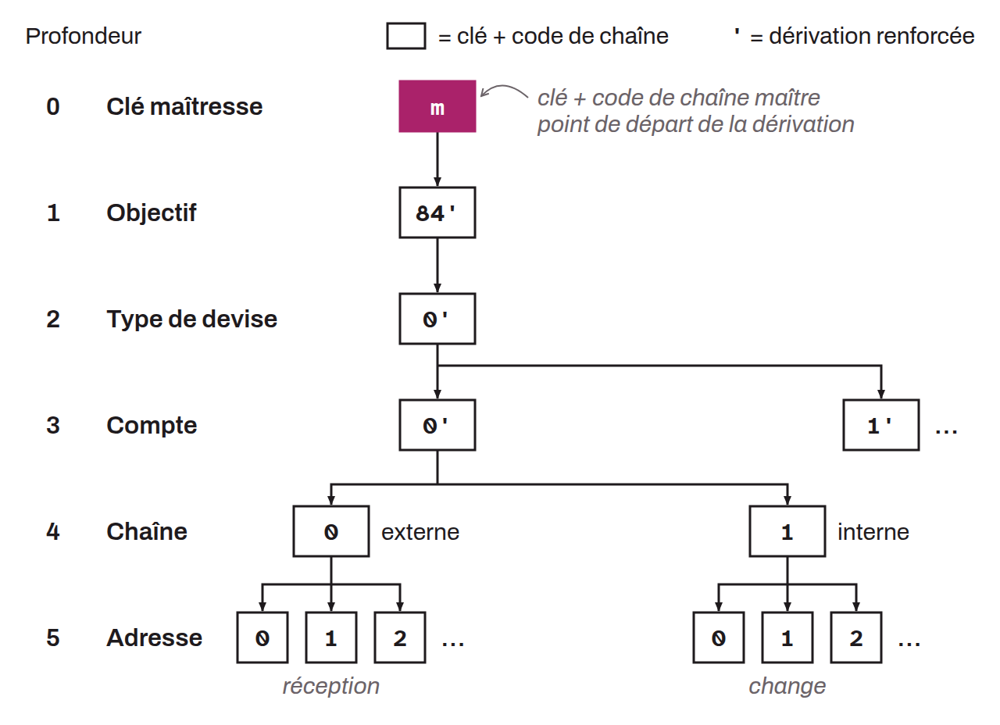

Unique private key derived from the seed of a hierarchical deterministic (HD) wallet. To obtain the master key, the `HMAC-SHA512` function is applied to the seed, using literally the words “Bitcoin seed” as the key. The result of this operation is a 512-bit output, of which the first 256 bits make up the master key and the remaining 256 bits form the master chain code. The master key and the master chain code are the starting point for deriving all the child private and public keys in the tree of the HD wallet. The master private key is thus at derivation depth 0.

