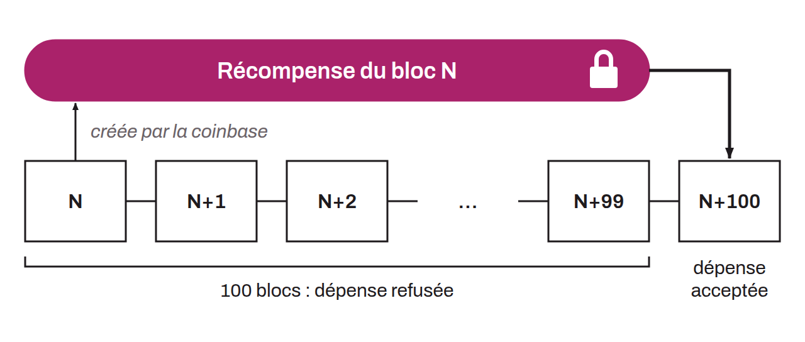

Delay required before a block reward can be spent by the miner who received it. This period is set at 100 blocks: the reward of block N can be spent only in block N+100 or a later block, by which point the coinbase transaction has 101 confirmations. Until then, the newly created bitcoin in the block reward cannot be spent. The purpose of this rule is to avoid complications from using bitcoin that comes from a chain that could later be made obsolete. Indeed, valid blocks sometimes end up invalidated when another block at the same height is included in a chain with more work. This phenomenon, called a reorganization, results in a “stale block” (also called an “orphan block”), depriving the miner of the bitcoin contained in the coinbase of the abandoned block. If newly created bitcoin were immediately spendable, any transaction involving it could be canceled after the fact, causing losses for the holders of that bitcoin. Such a scenario could lead to chains of cancellations of otherwise valid transactions, affecting every user involved in that chain of transactions. The maturity period is therefore a mechanism that prevents this risk. By imposing a delay of 100 blocks before newly issued bitcoin can be used, the rule keeps coins from blocks that end up invalidated from circulating and disrupting other transactions. The probability of a 101-block reorganization is so low that it is considered nil.

