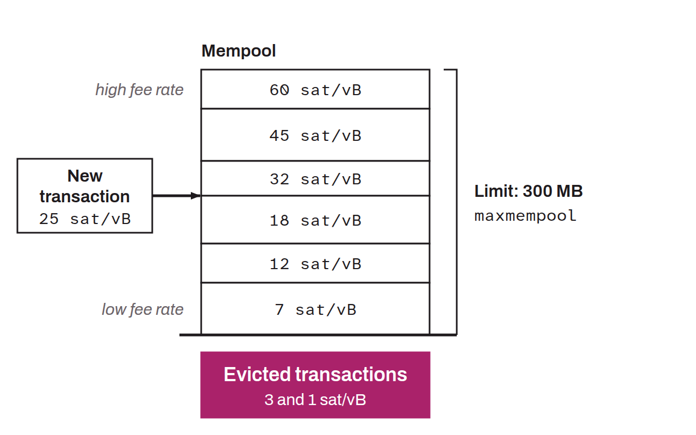

Event in which a Bitcoin node removes part of the pending transactions from its mempool. Each node keeps a set of unconfirmed transactions in memory, but this space is limited by resource constraints and by local policy rules. When certain conditions are met, the node evicts transactions to free up space.

The most common cause is exceeding the maximum allowed mempool size. In Bitcoin Core, this limit is set by default to 300 MB through the `maxmempool` option. When this threshold is reached, the transactions that offer the lowest fee rate are evicted first, so as to keep only those most likely to be included in an upcoming block. A transaction can also be evicted if it stays pending too long without being confirmed. By default, this expiry time is 336 hours, or 14 days, set through the `mempoolexpiry` option.

An evicted transaction is not permanently canceled. It can be rebroadcast on the network by its sender or by another node that still holds it in its own mempool. Eviction is a local resource management mechanism, not a permanent rejection by the protocol.
