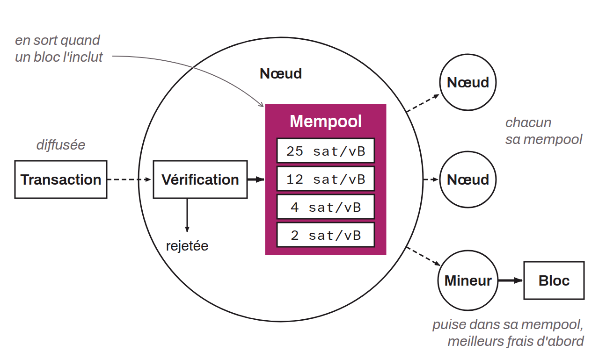

Contraction of the terms "memory" and "pool", referring to a virtual space in which Bitcoin transactions waiting for inclusion in a block are held. When a transaction is created and broadcast on the Bitcoin network, it is first verified by the network's nodes. If it is considered valid and complies with the node's local policy (standardness, minimum fees), it is placed in the mempool of each node, where it stays until a miner selects it for inclusion in a block.

Each node on the Bitcoin network maintains its own mempool, so the contents of the mempool can vary between nodes at any given time. Notably, the `maxmempool` option in each node's `bitcoin.conf` file lets operators control the amount of RAM (random-access memory) their node uses to store pending transactions in the mempool. By limiting the size of the mempool, node operators can prevent it from consuming too many resources on their system. This option is specified in megabytes (MB). The default value in Bitcoin Core is 300 MB since version 0.12.0.

Transactions in mempools are provisional. They should not be considered final until they are included in a block, and even then only after a certain number of confirmations. They can often be replaced or evicted. A transaction leaves a node's mempool when a block containing it is connected, when it expires (after 14 days by default in Bitcoin Core, option `mempoolexpiry`), or when it is evicted, for example because the mempool is full or because another transaction replaces it.
