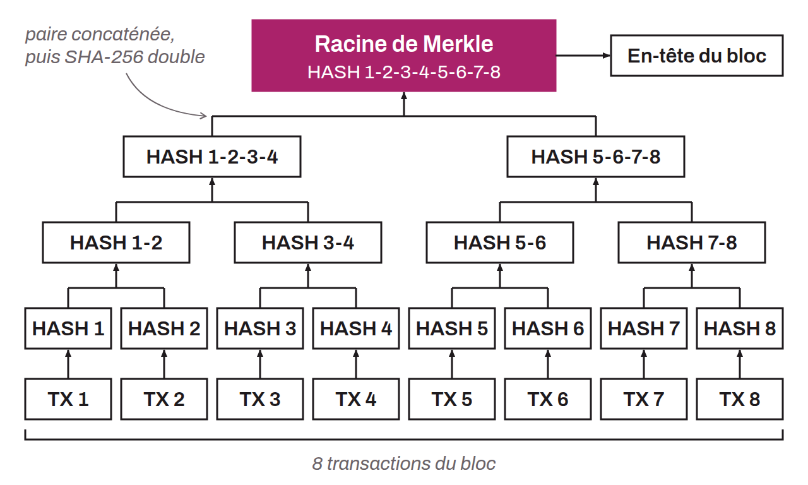
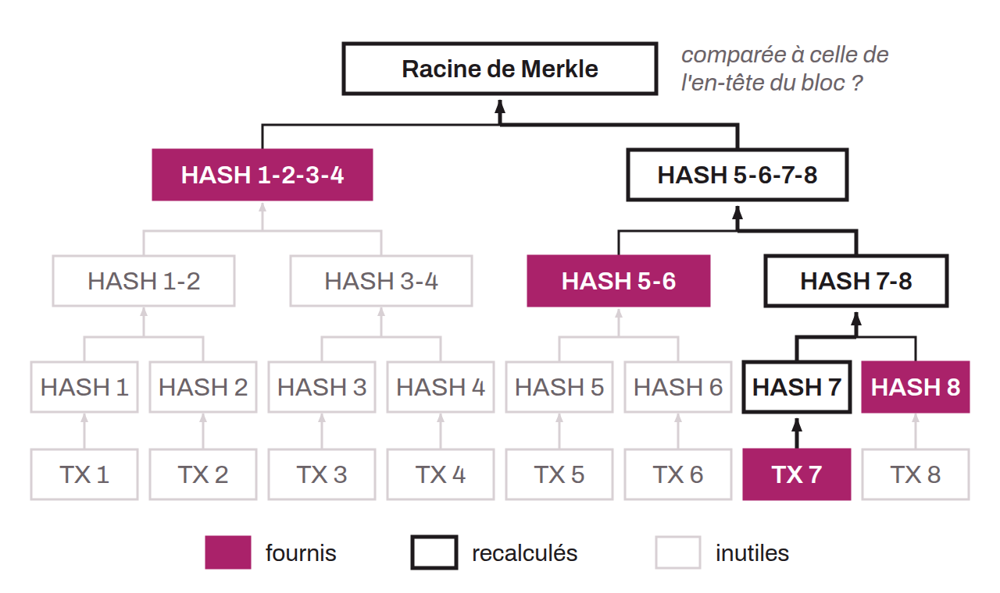

Cryptographic accumulator, a method for proving that a given piece of information belongs to a larger set. It is a data structure that makes it easier to verify information in a compact format. In the Bitcoin system, Merkle trees are used to group and condense the transactions of a block into a single hash, called the Merkle root. Each transaction is hashed, then adjacent hashes are hashed together hierarchically until the Merkle root is obtained.

This structure makes it possible to quickly verify whether a specific transaction is included in a given block without having to analyze all the transactions. For example, to verify that `TX 7` is part of the tree when only the Merkle root is available, the following proofs are all that is needed:
* `TX 7`;
* `HASH 8`;
* `HASH 5-6`;
* `HASH 1-2-3-4`.
With these few pieces of information, the intermediate nodes can be computed all the way up to the Merkle root.

Merkle trees are notably used by light clients (so-called SPV nodes), which keep only block headers, not transactions. The structure is also found in the Utreexo protocol, a protocol for condensing nodes' UTXO set, and in Taproot's MAST.

*The Merkle tree is named after Ralph Merkle, a cryptographer who designed this structure in 1979. A Merkle tree is also called a "hash tree".*
