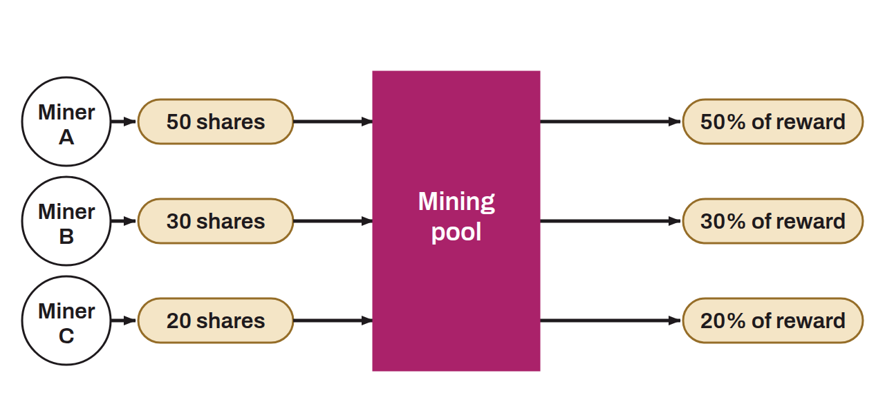

Group of miners who collaborate by combining their computing power to search for valid proofs of work on Bitcoin. Pooling into a single organization is a response to the growing difficulty of mining bitcoin, which makes it too unlikely for an individual miner to compete and win rewards on a steady basis. The miners in a mining pool contribute their machines to the search for valid shares. When the pool mines a block, the reward, which includes the newly created bitcoin and the transaction fees included in the block, is distributed among the members of the pool according to the chosen payout method. This distribution is proportional to the computing power each miner contributed.

By joining forces, the miners in a pool increase their chances of finding blocks and thereby reduce their variance. This ensures a steadier, more predictable source of income than solo mining, where a miner can go without a reward for long periods. Miners can thus smooth their earnings and gain better visibility over their business, notably to cover the various costs it entails.

*A mining pool should not be confused with a mining farm.*
