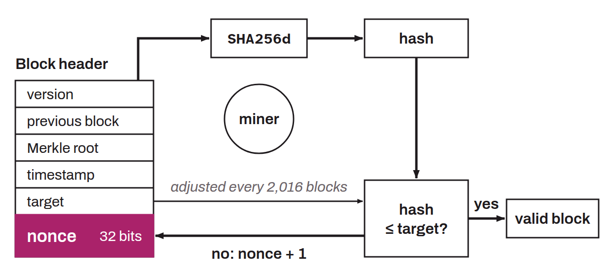

Participation in the proof of work of the Bitcoin system. Proof of work is a mechanism for resisting Sybil attacks. It underlies Nakamoto consensus, the principle used to reach agreement on a single version of the distributed ledger among the nodes of the network.

In practice, mining is the search for a value that, once passed through a hash function (`SHA256d`), gives a result lower than or equal to a target number. Nodes adjust this proof-of-work target every 2,016 blocks. This is known as the difficulty adjustment. The target number is lowered to increase the mining difficulty, or raised to decrease it, depending on how the computing power deployed by miners changed during the previous period.

This work is rewarded for each valid block found. The winning miner collects a monetary reward made up of the block subsidy (the creation of new bitcoin out of thin air) and the transaction fees. Today, the proof-of-work difficulty on Bitcoin is such that mining requires a great deal of computing power to win blocks. As a result, a miner often needs specialized chips designed to run `SHA256d`, called ASICs, and has to join mining pools.
