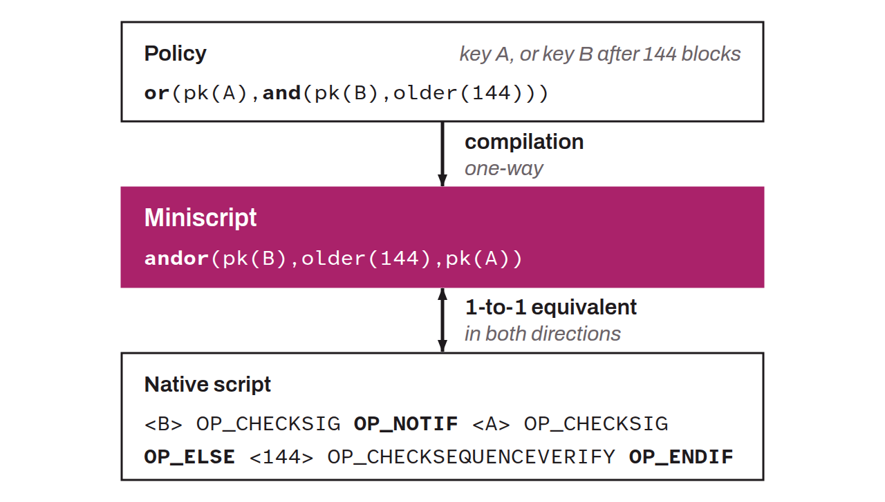

Framework for programming scripts securely on Bitcoin. Bitcoin's native language is called Script. It is quite complex to use in practice, especially for sophisticated, customized applications. Above all, it is very difficult to verify the limitations of a script. Miniscript uses a subset of Bitcoin Script to simplify the creation, analysis, and verification of scripts. Each miniscript maps one to one onto a native script. An easy-to-use policy language is compiled into miniscript, which in turn corresponds to a native script.

Miniscript thus lets developers build sophisticated scripts in a safer and more reliable way. Its essential properties are the following:
* It allows static analysis of a script, notably of the spending conditions it allows and of its cost in terms of resources;
* It produces scripts that comply with consensus rules;
* It makes it possible to analyze whether or not the different spending paths comply with the standardness rules of nodes;
* It establishes a general standard, understandable and composable, for all wallet software and hardware.

The Miniscript project was launched in 2018 by Pieter Wuille, Andrew Poelstra, and Sanket Kanjalkar, through the company Blockstream. Miniscript was added to the Bitcoin Core wallet in watch-only mode in December 2022 with version 24.0.1, then spending from P2WSH scripts became possible in May 2023 with version 25.0. Miniscript arrived in Taproot scripts in December 2023 with version 26.0.
