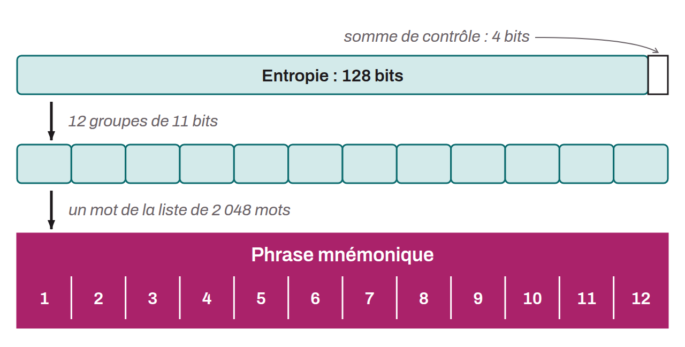

Sequence of words, usually 12 or 24, generated pseudorandomly from a source of entropy. It is also known as a recovery phrase, mnemonic, seed phrase, or secret phrase. The pseudorandom sequence is always completed with a checksum. The mnemonic phrase, together with an optional passphrase, is used to deterministically derive all the keys associated with a hierarchical deterministic (HD) wallet. This means that from this phrase, it is possible to deterministically generate and recreate all of the Bitcoin wallet's private and public keys, and therefore to access the funds associated with it. The purpose of the mnemonic phrase is to provide a way to back up and recover bitcoin that is both secure and easy to use.

It is important to keep this phrase in a safe and secure place, because anyone in possession of the mnemonic would have access to the funds of the corresponding wallet. When used with a conventional wallet and without the optional passphrase, it is often a single point of failure (SPOF). The mnemonic phrase is thus an encoding of the pseudorandom sequence and the checksum into everyday words, which makes it easier for humans to write down and read. It is built according to the BIP-0039 standard, which defines and orders a list of 2,048 words used for this encoding.

*The BIP-0039 list of 2,048 words is available in several languages. However, it is advisable to use only the English version, because it is the most widely supported by wallet software.*
