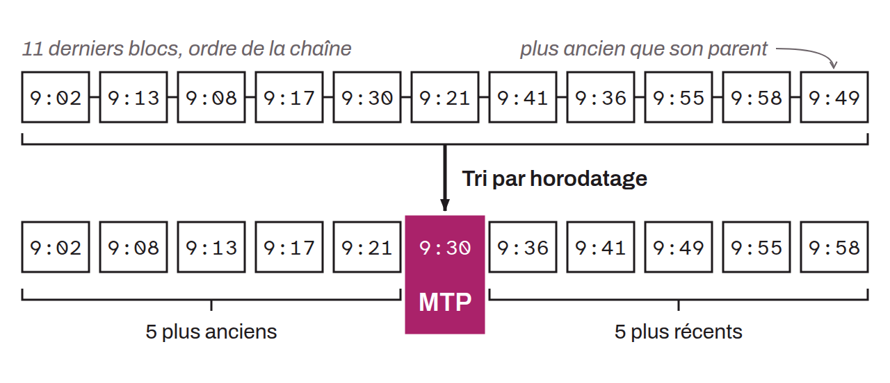

Concept used in the Bitcoin protocol to determine a margin around the network's consensus timestamp. MTP is defined as the median of the timestamps of the last 11 mined blocks. Using this indicator avoids disagreements between nodes about the exact time in case of clock drift. MTP was initially used to check the validity of block timestamps against the past. Since BIP-0113, it is also used as the network's time reference for checking the validity of timelock operations (`nLockTime`, `OP_CHECKLOCKTIMEVERIFY`, `nSequence`, and `OP_CHECKSEQUENCEVERIFY`).

