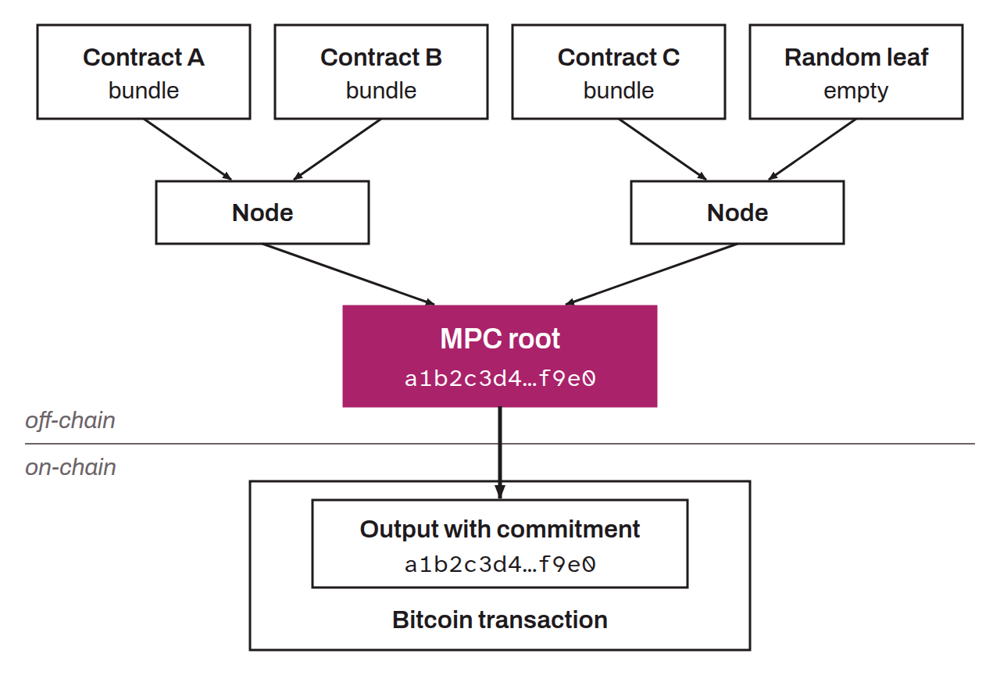

Merkle tree structure of the RGB protocol, abbreviated MPC, designed to embed, within a single Bitcoin transaction, several Transition Bundles from distinct contracts. This mechanism groups various commitments, corresponding to different contracts or assets, into a single anchor point. By consolidating these transitions in a hierarchical structure, the MPC optimizes the use of block space, reducing transaction fees and improving the efficiency of blockchain use.

