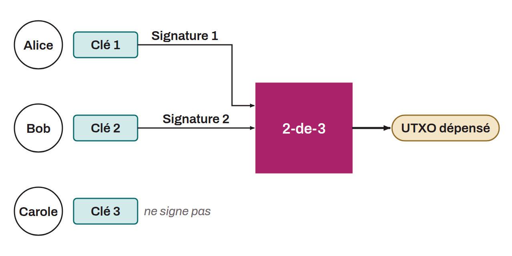

Multisignature wallets, often abbreviated "multisig," are designed to strengthen the security of bitcoin by requiring several signatures from different private keys to authorize a spend. This method spreads the risk across several keys, which reduces both the risk of loss and the risk of theft (depending on the multisig configuration). Multisig wallets work on an "m-of-n" model, where `m` is the minimum number of signatures required to validate a transaction, and `n` the total number of keys involved. For example, a 2-of-3 configuration requires two signatures out of three possible ones to validate a transaction. This approach offers higher security than single-key wallets, but it also introduces more complexity in management and backup. Moreover, transactions using the old multisig standards are less private and more expensive in fees than regular singlesig transactions. However, since the activation of Taproot in November 2021, and with the use of descriptors, these drawbacks can be reduced or even eliminated.

*Some bitcoiners distinguish the terms "multisig" and "threshold multisig." Some claim that a multisig is necessarily n-of-n, whereas a threshold multisig is m-of-n. In everyday language, however, it is accepted to say "multisig" even for m-of-n.*
